# 棒球赛事管理系统 · 用户使用手册

> 版本：v1.11 ｜ 更新：2026-10-16 ｜ 适用：新版前端（`/bs-ball-next/`，生产与测试）· 球队去联盟归属 + 排赛报名制 + 秩序册整册页 + 门户信息架构优化 + 撤销报名
> 本次要点：① **球队不再隶属联盟**——球队是租户级实体，参赛经"赛事报名"参与多个办赛方的比赛；受限身份（赛事主办方/球队负责人）**新建球队后自动成为该队负责人**（原"主办方代管无主球队"取消；无主球队由租管/超管指派负责人）。② **新建赛事默认"报名制"**——建比赛时主客队仅可选**已确认报名且锁定名单**的球队，且至少两支球队完成报名后才能开始排赛（历史赛事保持宽松口径）。③ **新增「秩序册（整册）」页**——主办方在「参赛球队」页头点「**整册**」，一页查看全部**已确认**球队的**在役**报名球员（**卡片视图/列表视图**可切换：卡片按球队聚合展示照片/守备位置/姓名/背号；列表按姓名排序、含报名球队列），支持浏览器打印（可存 PDF）；未提交名单的球队标注占位。④ **门户信息架构优化**——导航「联盟球队」更名为「**球队**」；「**联盟**」页点卡片进入**联盟详情**（查看下辖赛事并可点进赛事赛程）；「**球队**」页末位新增「**自由球员**」入口（本租户所有无现属球队球员，含退役）。⑤ **球队可撤销报名**——球队在「赛事报名」中可**自助撤销**（仅在该队尚无已开赛比赛前）；撤销后主办方侧参赛列表与整册同步移除，如需再参赛由主办方重新邀请；已排赛程保留，由主办方后续处理。
> 截图环境：测试环境 `test.bsdone.com`（示例账号：`demo_admin` 等演示号）
> 本手册按**角色层级从高到低**组织（超级管理员 → 租户管理员 → 赛事主办方 → 球队负责人 → 球员）。请先在第 1 节找到你的角色，再进入对应章节。

---

## 1. 角色与权限总览

系统按五个层级管理账号与数据（另有免登录的"游客"）：

| 层级 | 角色 | 一句话职责 | 数据范围 |
|---|---|---|---|
| 平台方 | **超级管理员** | 平台运营与最终处置 | 全部租户、全部数据 |
| 租户方 | **租户管理员** | 本租户运营（账号/角色/删除） | 本租户全量 |
| 办赛方 | **赛事主办方** | 组织赛事与赛程 | 自有联盟 + 自己负责的球队 |
| 球队方 | **球队负责人**（球队管理员） | 管理本队与队员 | 本队 |
| 球员 | **球员账号** | 维护本人档案、入队/离队 | 本人档案 |
| 访客 | 游客 | 浏览公开数据 | 公开信息 |

> 三层权限：登录与菜单（看得到）→ 接口权限（调得到）→ 行级数据范围（动得到）。越权时按钮隐藏、接口再拒（403）双保险。

**归属与接管规则（重要）**：
- 球队是租户级实体，**不隶属任何联盟**；球队经赛事报名（电子秩序册）参与多个办赛方的比赛。
- **创建即负责**：受限身份（赛事主办方/球队负责人等）新建球队后**自动成为该队负责人**；球队的建档、邀请入队等事务由本队负责人办理；无主球队由租管/超管指派负责人。
- 球员档案被本人**认领**后，球队/主办方只能走流程（邀请、审核进队），不能直接改其档案。
- **建档即归属**：主办方/球队负责人新增球员时须选定「当前球队」（从球队入口进入会自动带出）；未归属球队的球员不会出现在受限角色的球员列表（球员管理页不提供「自由球员」筛选，含已离队且未加入新队者），也无法再编辑绑定；找自由球员请用本队「邀请球员」的候选搜索（见 §7）。

---

## 2. 通用：门户与登录

### 2.1 门户（所有人）

- 地址：`https://<域名>/<新版前缀>/<租户码>`（生产：`https://www.bsdone.com/bs-ball-next/<租户码>`；测试环境：`https://test.bsdone.com/bs-ball-next/bs-ball`）。
- 门户首页可浏览：赛事一览、联盟、球队（含**自由球员**）、资讯公告等；「联盟」页点卡片进入**联盟详情**（联盟信息 + 下辖赛事，可点进赛事赛程）。
- 赛事一览中，每个赛事标题栏可下载**赛程表**与**报名名单** PDF。报名名单按球队聚合并实时读取最新数据，后台报名名单修改后再次下载即可获得更新内容。
- 右上角**账号菜单**：登录/注册、**进入管理后台**（有管理权限的账号才出现）、个人资料、退出登录。

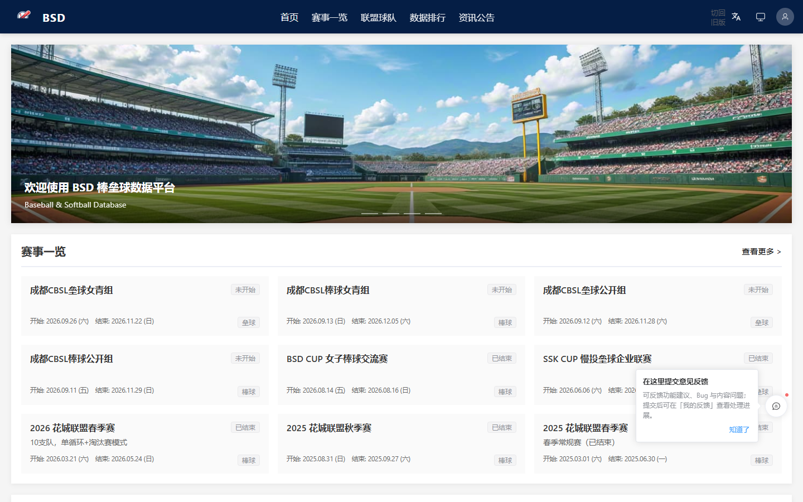

### 2.2 登录

- 门户登录：右上角「登录」→ 账号登录页（可用手机号/用户名）。

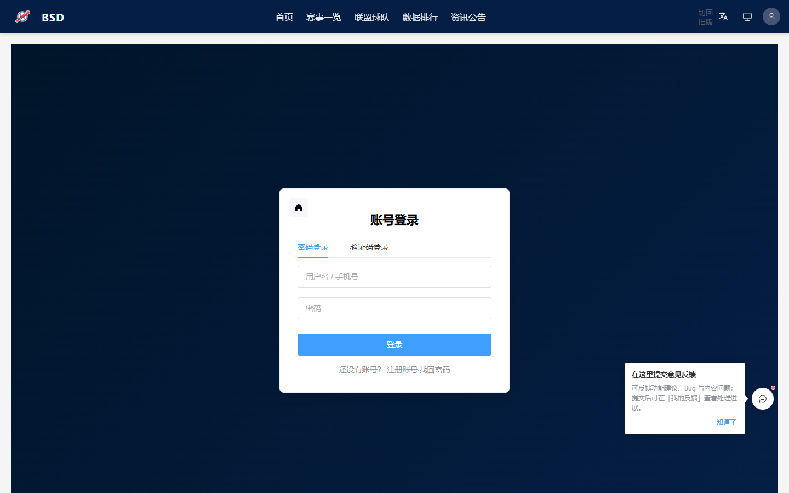

- 管理后台登录：`https://<域名>/<新版前缀>/<租户码>/admin/login`（用户名+密码；测试环境无图形验证码）。
- 登录后自动进入**你第一个有权限的菜单**（如超级管理员进"工作台"、球队负责人进"球队管理"）。

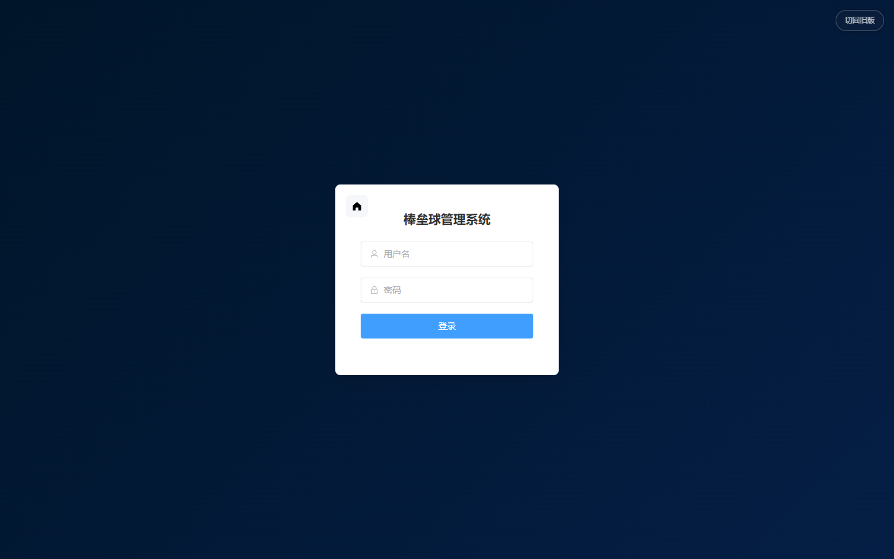

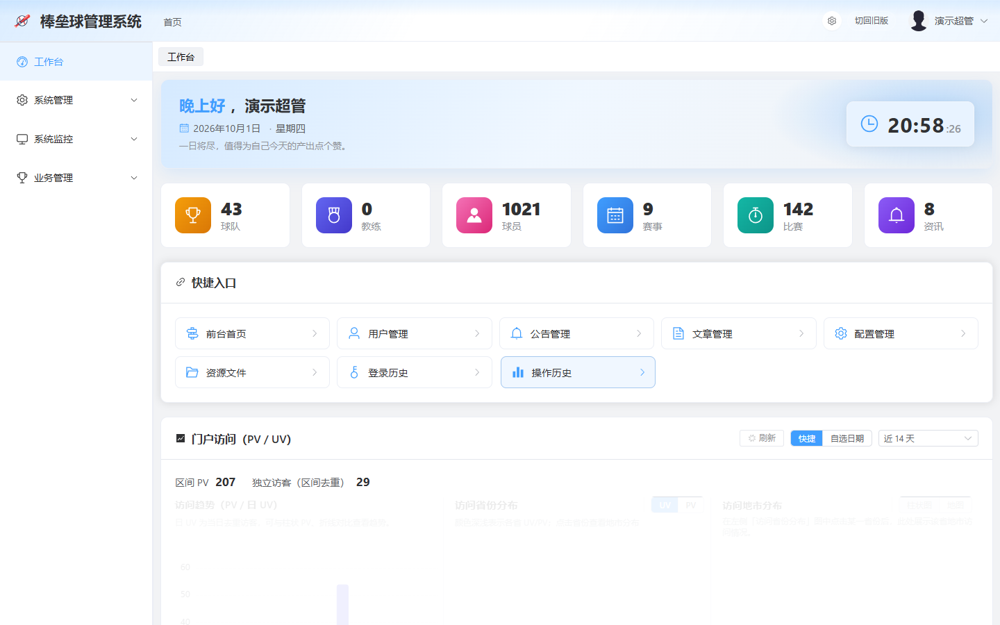

---

## 3. 创建与管理各级账号（管理员）

> 除"球员账号"（由用户自助注册）外，**所有后台账号都在「用户管理」中创建并勾选角色**，一步完成层级设定。

| 要创建的账号 | 勾选角色 | 之后绑定范围的方式 |
|---|---|---|
| 租户管理员 | 租户管理员 | 勾选"可访问租户" |
| 赛事主办方 | 赛事主办方 | 在自有联盟内作业（建联盟/被指派后即生效）；新建球队后自动成为该队负责人 |
| 球队负责人 | 球队负责人 | 由本人登录后**创建球队自动成为负责人**（或由平台配置指定） |
| 球员 | （普通用户注册后） | 门户提交认领/接受球队邀请 |

### 3.1 用户管理入口

### 3.2 新增用户（以"租户管理员"为例）

1. 点击右上角「**新增**」→ 打开「新增用户」；
2. 填写：用户名（仅小写字母与数字）/ 昵称 / 密码；
3. 在「**角色**」中选择目标层级（如"租户管理员"）；
4. 选择「**租户**」（可访问租户，至少一项）；其余选填；
5. 「确定」保存，即创建成功。

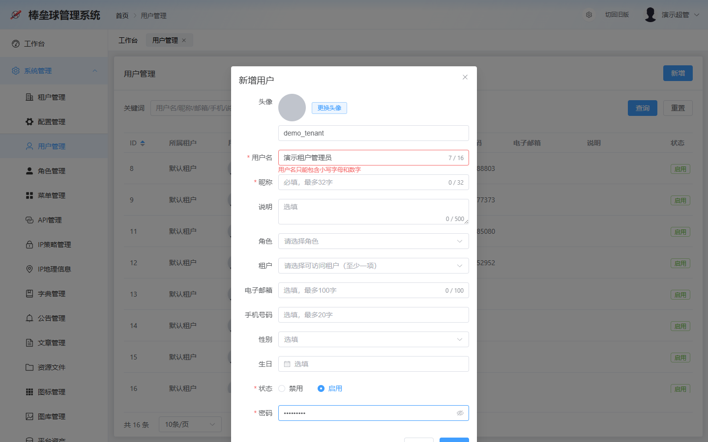

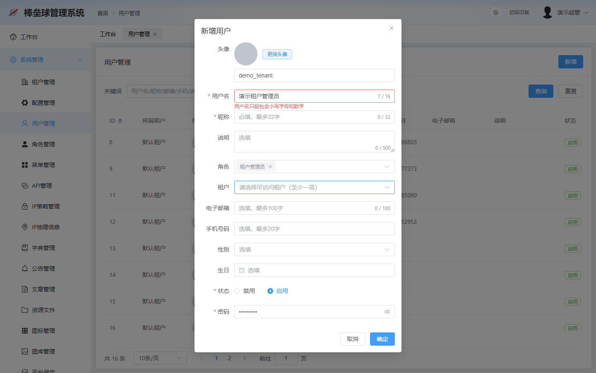

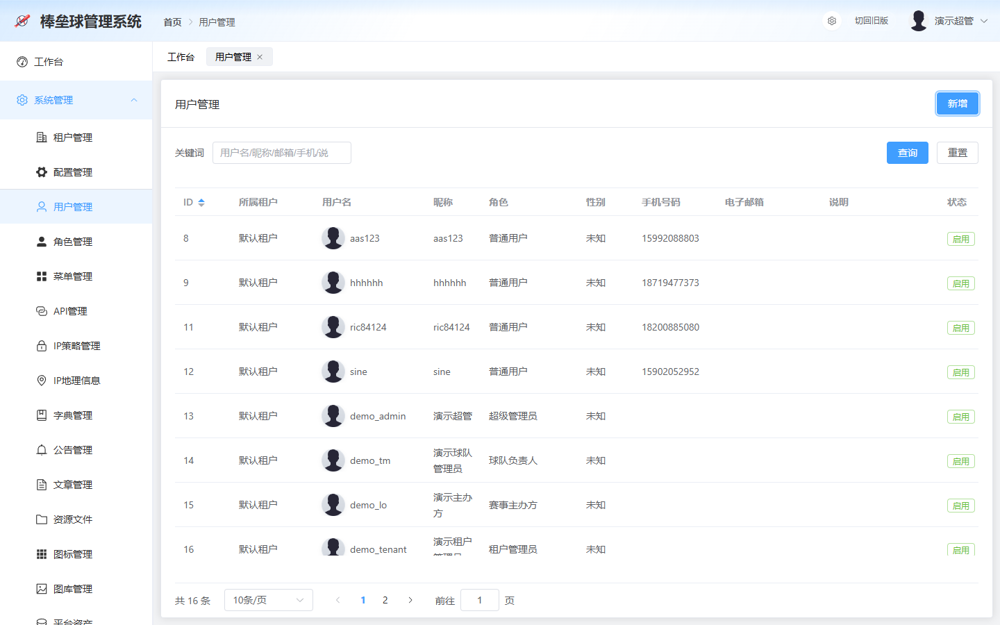

> 同理可创建「赛事主办方」「球队负责人」账号，只需在"角色"处选择对应项。

### 3.3 赛事主办方的联盟作业面

赛事主办方登录后进入 业务管理 → **联盟管理**，在自有联盟域内创建赛事与赛程。

**加入联盟的两种方式**：① 由超管/租管在联盟行「主办方」中**指派**；② 在管理台发起「**申请成立联盟**」→ 上级（超管/租管）在「建盟申请」中审核通过后**自动成为该联盟主办方**。注意：门户侧**没有**申请入口，申请统一在管理台发起。

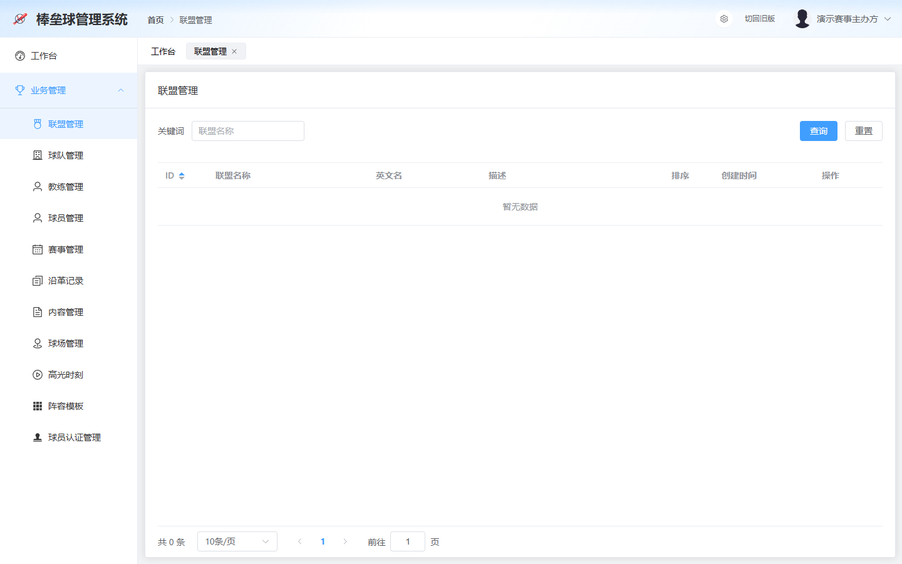

### 3.4 球队负责人绑定球队（自动授职）

球队负责人账号登录后，进入 业务管理 → **球队管理** → 「新增球队」，填写队名等并保存——**创建者自动成为该队负责人**。

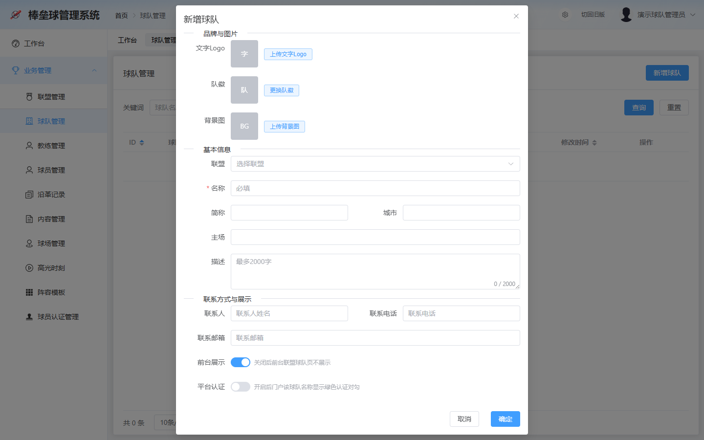

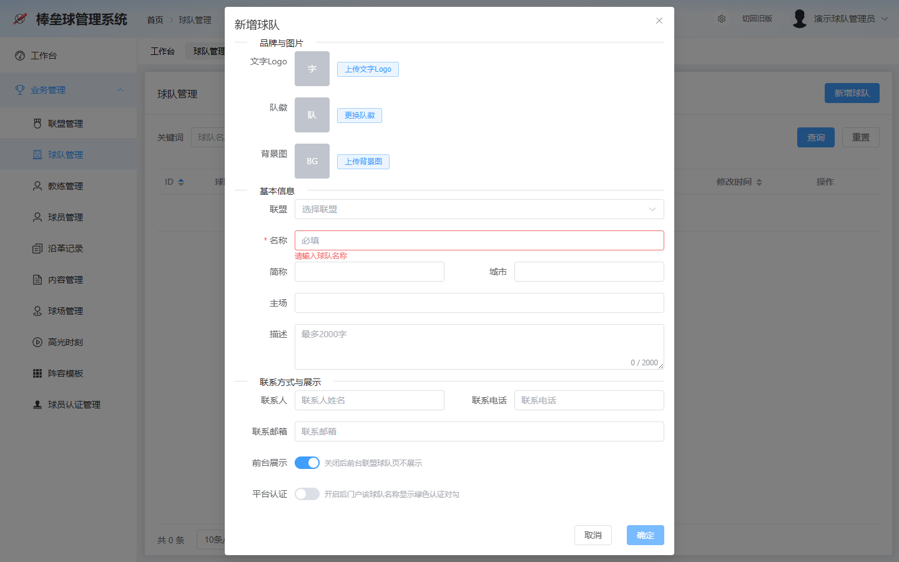

### 3.5 角色与目录权限

- **角色管理**：查看/配置角色（租户管理员可为"球队负责人/赛事主办方"配置**本租户专用**的菜单目录——「租户目录」入口，见下节）。
- **超级管理员**可配置全部角色（含平台角色的全局权限）。

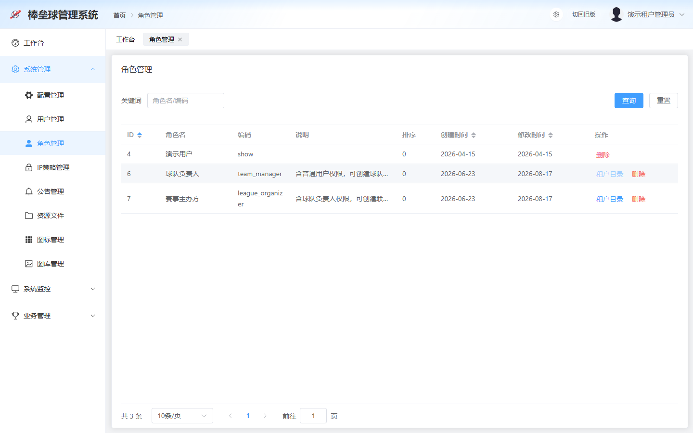

> 「租户目录」打开后：开启「启用租户级目录覆盖」→ 勾选该角色在本租户可见的菜单 → 保存即生效；「清除覆盖」恢复全局默认。覆盖仅调整菜单/按钮导航面，不改变数据范围。

---

## 4. 超级管理员

拥有全部租户与全部功能，另含平台级工具：

| 功能 | 入口（系统管理下） | 说明 |
|---|---|---|
| 租户管理 | 租户管理 | 新建/停用（退租）租户。**退租=该租户整体无法登录、门户"找不到"**，数据冻结保留 |
| 平台资产 | 平台资产 | 各租户「删除」（归还平台）的历史数据汇总 |
| 角色/菜单/API/字典 等 | 系统管理、系统监控 | 全局配置 |

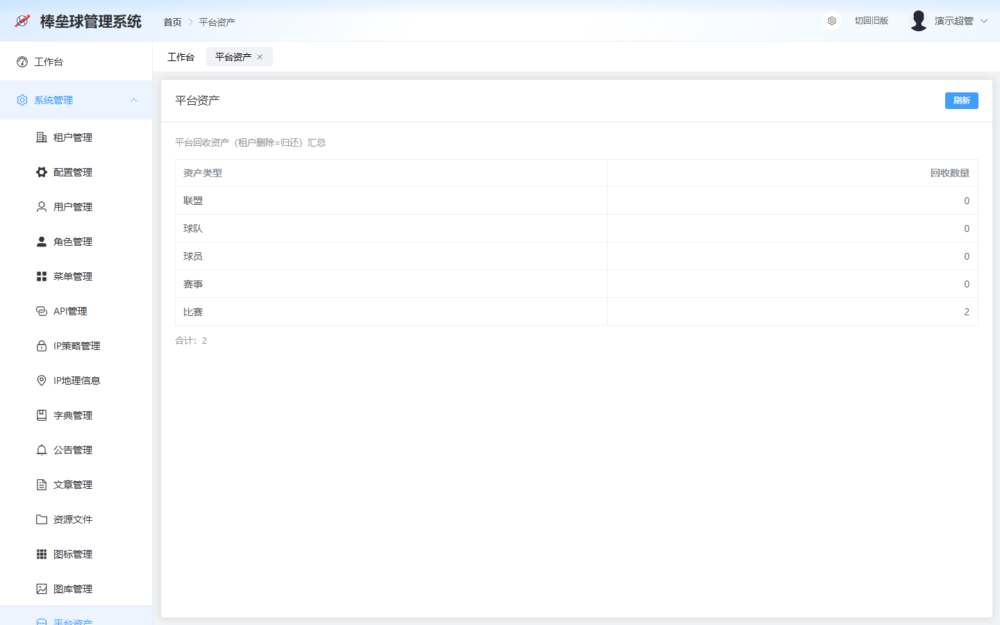

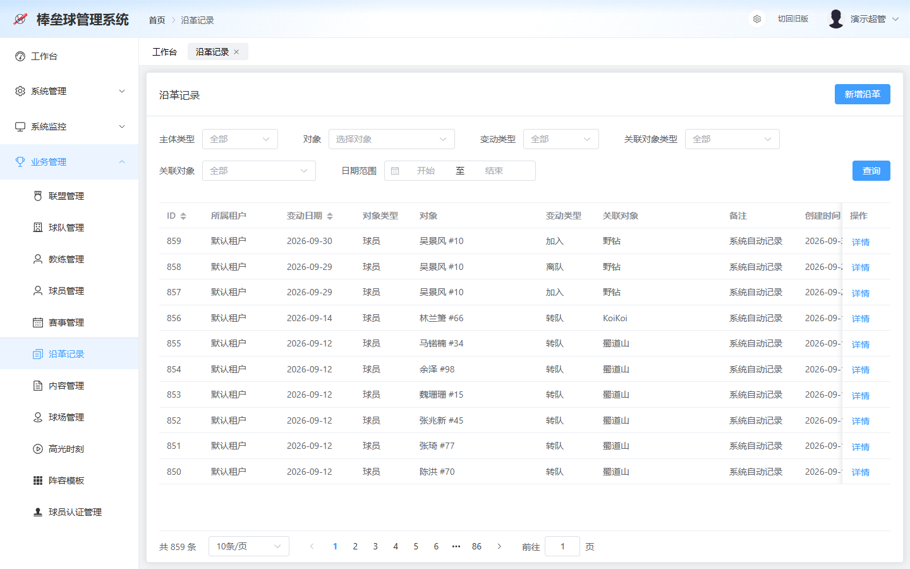

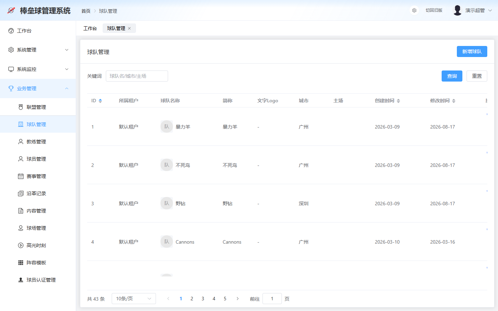

---

## 5. 租户管理员

本租户运营全权，但**不能销毁历史数据**——你界面的「删除」=数据交平台留存（不销毁）：

| 功能 | 入口 | 说明 |
|---|---|---|
| 用户与角色 | 系统管理 → 用户管理 / 角色管理 | 创建本租户各级账号、配置目录 |
| 租户级目录配置 | 角色管理 → 平台角色行「租户目录」 | 为"球队负责人/赛事主办方"配置本租户专用菜单 |
| **删除**（归还平台） | 球员/球队/赛事/比赛/联盟/教练/球场/高光 → 行内「**删除**」 | 数据从本租户运营面移除、**由平台留存**（不销毁）；删除历史数据不可自行恢复（球员可在「数据范围：已删除」找回） |
| **解除认领** | 球员管理 → 已认领球员行「**解除认领**」 | 修正错误认领：档案回到未认领、可重新被邀请/认领；记录沿革审计 |
| 球员认领审核 | 球员认领审核 | **租管=租户内超管**：默认可见本租户**全部**待办（含“审核方=球队负责人”类），可看可审；「审核方」筛选可切换查看。审核人按归属分流：队有负责人→该队负责人；无负责人→平台/租管 |
| **恢复球员** | 球员管理 → 顶部「数据范围」切「**已删除**」 | 误删球员找回：行内「**恢复**」即回到球员列表（恢复=清除删除标记与平台留存标记；删除口径不变） |

> 租管与超管界面均显示「删除」：租管的「删除」=交平台留存，超管的「删除」为平台最终处置（不进平台资产统计）；球队侧删除球员仅限「移除出球队」。

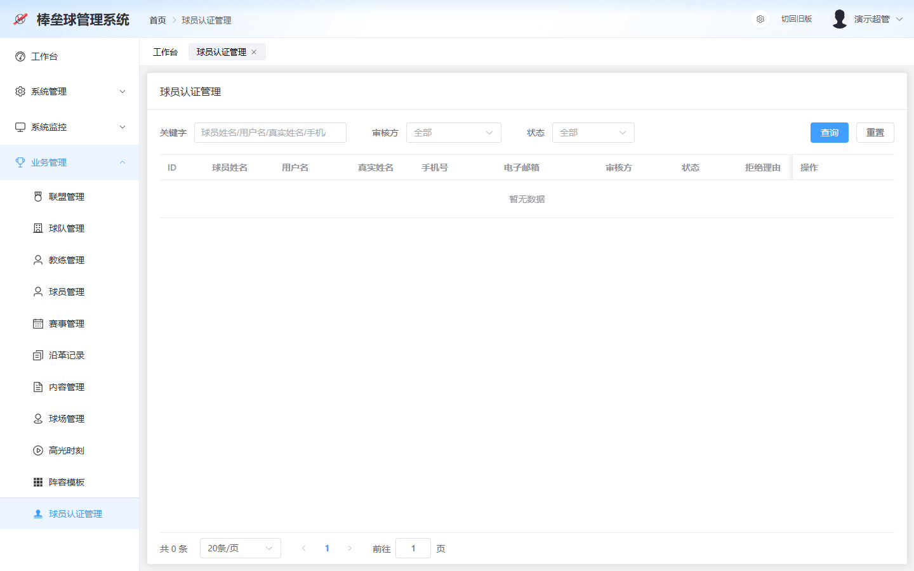

---

## 6. 赛事主办方（联盟管理员）

| 场景 | 入口 | 说明 |
|---|---|---|
| 加入/创建联盟 | 联盟管理 → 「**申请成立联盟**」（上级审核）/「新增联盟」 | 申请经超管/租管审核通过后自动成为主办方；管理员的「新增联盟」为直建 |
| 负责人管理 | 球队管理 → 行内「**负责人**」 | 仅限**自己负责的球队**（增/解本队负责人）；无主球队的指派由租管/超管办理 |
| 解散球队 | 球队管理 → 行内「**解散**」 | 队员离队、负责人失效（数据留存）；有未打完比赛则拒绝 |
| 批量球员建档 | 球员管理 → 「导入数据」 | **仅限自己负责的球队**（详见 §10） |
| 创建赛事 | 赛事管理 → 「发布赛事」 | 含赛制、阶段；**新建赛事默认"报名制"** |
| **邀请球队参赛** | 赛事管理 → 赛事行「**参赛球队**」 | 邀请球队报名（可多选，候选=本租户全部球队）；列表可见 待确认/已确认/已谢绝 |
| 名单锁定/解锁 | 参赛球队 → 行内「**锁定**」/「解锁」 | 锁定后球队不能再修改报名名单；「移除」须先解锁；**锁定名单是排赛前提** |
| 移除参赛 | 参赛球队 → 行内「**移除**」 | 移除该队参赛登记与其报名名单（留存为软删） |
| 查看报名名单 | 参赛球队 → 行内「**查看名单**」 | 球员/背号/位置与「是否仍在队」提示 |
| **秩序册（整册）** | 参赛球队 → 页头「**整册**」 | 一页查看全部**已确认**球队的**在役**报名球员（卡片/列表视图可切换；列表按姓名排序、含报名球队列；未提交的标注占位）；「打印」可输出纸质或存 PDF |
| **邀请球员入队** | 球队管理 → 行内「**邀请球员**」 | 对**你负责的球队**可用：检索/翻页浏览本租户全部未在本队的球员 → 未认领球员点击「邀请入队」直接入队（保留其现有当前球队）；已认领球员生成邀请链接发给本人，确认后入队 |
| 赛程与录分 | 赛事管理 → 「赛程与结果」/ 比赛行「录入」 | 见 §9；建比赛选主客队=**已确认报名且锁定名单**的球队（新赛事报名制） |

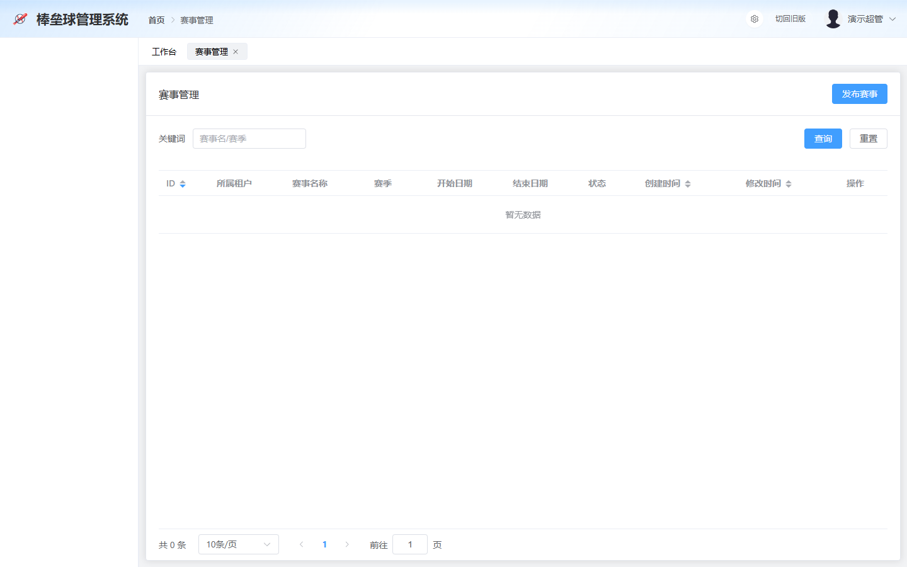

**电子秩序册（报名）流程**：主办方在赛事上**邀请球队** → 球队负责人在「赛事报名」中**确认参加**并**提交报名名单** → 主办方可**锁定**名单（锁定前球队可反复修改；已谢绝的球队可重新邀请）。球队在该队**尚无已开赛比赛**前可**自助撤销报名**（撤销后报名与名单从秩序册移除，如需再参赛由主办方重新邀请）。

---

## 7. 球队负责人（球队管理员）

登录后落到「球队管理」。可用功能（左侧业务管理下）：

| 功能 | 入口 | 说明 |
|---|---|---|
| 球队资料 | 球队管理 | 维护本队信息、队徽、主场等 |
| 管理球员 | 球队管理 → 行内「管理球员」 | 查看队员、邀请入队 |
| 球员建档（单个/批量） | 球员管理 → 「新增球员」/「导入数据」 | **仅限本队**；须选定「当前球队」（从本队入口进入自动带出） |
| **移除球员出球队** | 球员管理 → 行内「**移除出球队**」 | 球队侧不能删除球员；无比赛记录→删除该队经历；有比赛记录→保留历史记为离队（已认领球员同样适用） |
| 球员认领审核 | 球员认领审核 | 本队球员的认领由你审核（通过/驳回）；租管/超管可兜底代审 |
| 负责人管理 | 球队管理 → 行内「负责人」 | 本队负责人列表与解除 |
| 解散球队 | 球队管理 → 行内「解散」 | 队员离队、数据留存（非“销毁”）；删除仍属租管职责 |
| 阵容模板 | 阵容模板 | 复用比赛阵容 |
| **赛事报名** | 球队管理 → 行内「**赛事报名**」 | 查看受邀赛事：**确认参加 / 谢绝**；确认后**勾选本队球员提交报名名单**（锁定前可反复修改）；**撤销报名**仅在该队尚无已开赛比赛前可用，撤销后本队报名与名单从秩序册移除 |
| **邀请球员入队** | 球队管理 → 行内「**邀请球员**」（或本队球员页「邀请球员」） | 检索/翻页浏览**全部未在本队的球员**（含他队/自由球员，标注认领状态与现属球队）→ 未认领球员点击「邀请入队」即直接入队（球队经历追加该队并勾选当前，原当前球队保留）；已认领球员生成通用链接，发送给本人确认后入队；「已生成邀请」页签可查看/撤销 |
| 沿革记录 | 沿革记录 | 队员加入/离队等变动 |

**电子秩序册**：收到主办方邀请后，在「赛事报名」中确认参加，并从**本队当前在役球员**中勾选提交报名名单；名单锁定后只读展示。若需调整名单请在锁定前完成（锁定/解锁由主办方操作）。在**尚无已开赛比赛**前，可点行内「**撤销报名**」自助退赛——本队报名与名单将从秩序册移除，如需再参赛请联系主办方重新邀请；已有已排赛程的，赛程保留由主办方处理。

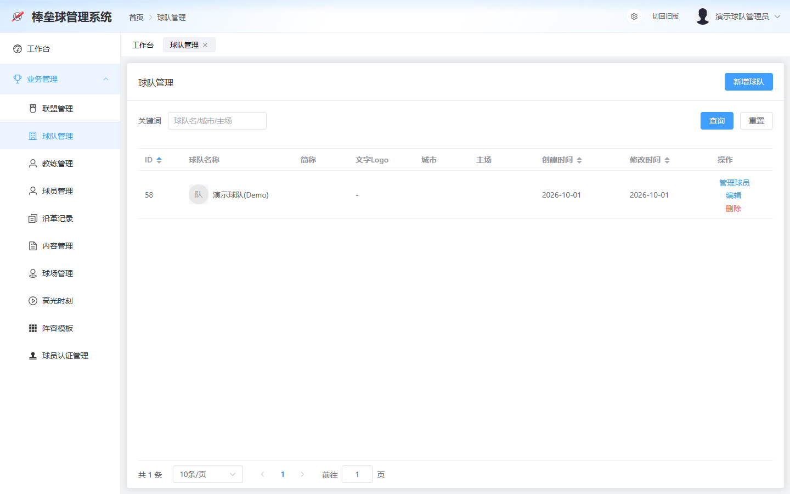

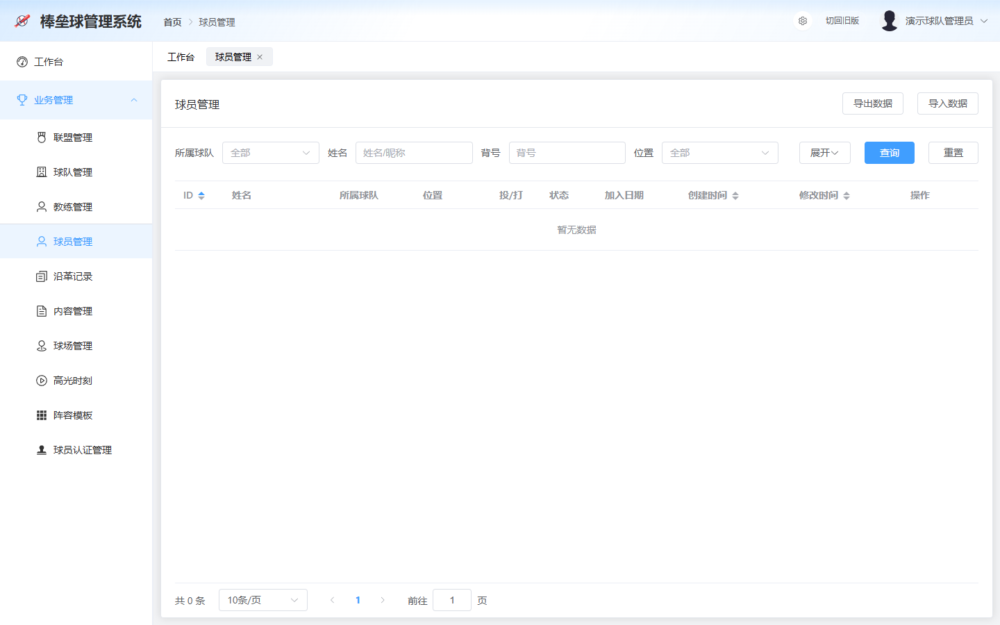

**两类变动走流程**：已认领球员入队由球队**邀请**、球员**接受**；未认领球员由球队代管，点击「邀请入队」即直接加入，球队经历追加该队并勾选当前（原当前球队保留），无需本人登录/同意。球员本人可在门户取消“当前球队”（离队）；球队侧可用「移除出球队」将球员移出（见上表）。有比赛记录的球队经历不可删除。邀请入口在「球队管理」行内「**邀请球员**」：候选为**全部未在本队**的球员（含他队与自由球员），可按姓名搜索并翻页浏览；已认领球员生成**通用链接**，撤销后链接即失效。

> 球队侧没有「删除/归还」按钮——球队的删除是租户管理员的职责（见 §5）；**球员的删除仅租管/超管，球队侧只能「移除出球队」**。「**解散**」语义为数据留存式下架，与“销毁”不同。

---

## 8. 球员账号

球员是"身份"（对应一份球员档案），能力集中在**门户**：

| 功能 | 入口 | 说明 |
|---|---|---|
| 自助建档 | 注册后门户提交 | 未入库球员可自助建档（姓名必填） |
| 编辑本人档案 | 门户 → 个人资料 | 身高体重、惯用手、守位等 |
| 接受邀请入队 | 邀请链接（通用链接） | 无档案者走「**建档入队**」表单，一次完成建档+入队 |
| 离队 | 个人资料 → 球队经历 | 取消勾选"当前球队"；有比赛记录的经历不可删除 |
| 解除认领 | 个人资料 → 我的认领（已通过）→ 「**解除认领**」 | 本人可解除错误认领；球队经历与比赛统计仍保留在档案中 |

已认领球员入队走"球队邀请→本人同意"；未认领球员由球队代管，邀请即入队、无需本人同意。离队本人自助完成。

---

## 9. 实时录入（比赛录分）

**入口**：业务管理 → 赛事管理 → 「赛程与结果」→ 比赛行「**录入**」（或从比赛管理进入）。

- 逐打席记录（安打/出局/保送/失误等），自动联动比分与统计；
- 实时录入中的选项与确认弹窗，可按住标题栏拖动，避免遮挡球场和球员背号；
- 保存后进入积分榜与球员数据统计。

> **秩序册限制**：若该赛事已启用报名（有球队报名记录），阵容录入时只能选择该队**已报名球员**；未报名/未提交名单的球队将无可选球员，请先完成报名（见 §6/§7）。
>
> **排赛门槛（报名制）**：**新建赛事默认"报名制"**——建比赛 / 编辑比赛时主客队仅可选**已确认报名且锁定名单**的球队，且该赛事需至少两支球队完成上述步骤后才能开始排赛；历史赛事保持宽松口径（不受此限）。

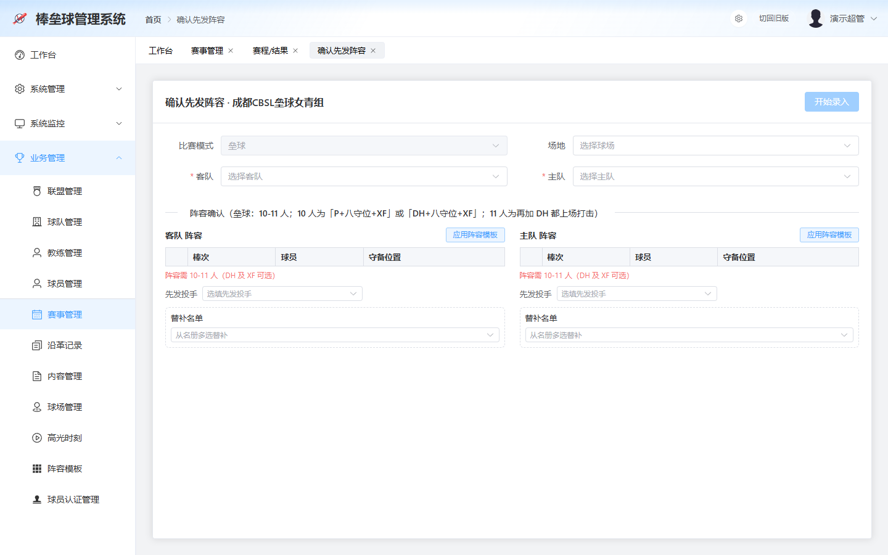

---

## 10. 批量球员建档（Excel 批量导入）

> 对应需求「球员批次建档」——已上线并完成权限接入。

**入口**：球员管理 → 工具栏「**导入数据**」。

**步骤**：① 按模板整理名册（姓名必填；出生日期 `YYYY-MM-DD` 选填）；② 上传 Excel；③ 系统逐行建档并挂到指定球队，**姓名+出生日期重复的行自动跳过**；④ 档案为"未认领"；球队邀请时未认领球员直接入队，球员之后仍可在门户认领本人档案。

**权限口径**：

| 角色 | 可批量建档范围 |
|---|---|
| 超级管理员 / 租户管理员 | **任何时候全权**，不限球队 |
| 赛事主办方 | 仅**自己负责的球队**（新建球队后自动成为该队负责人） |
| 球队负责人 | 仅**本队** |

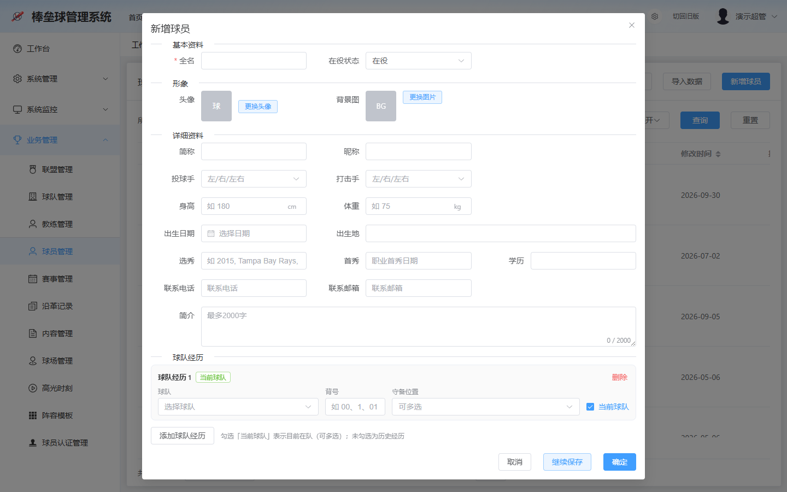

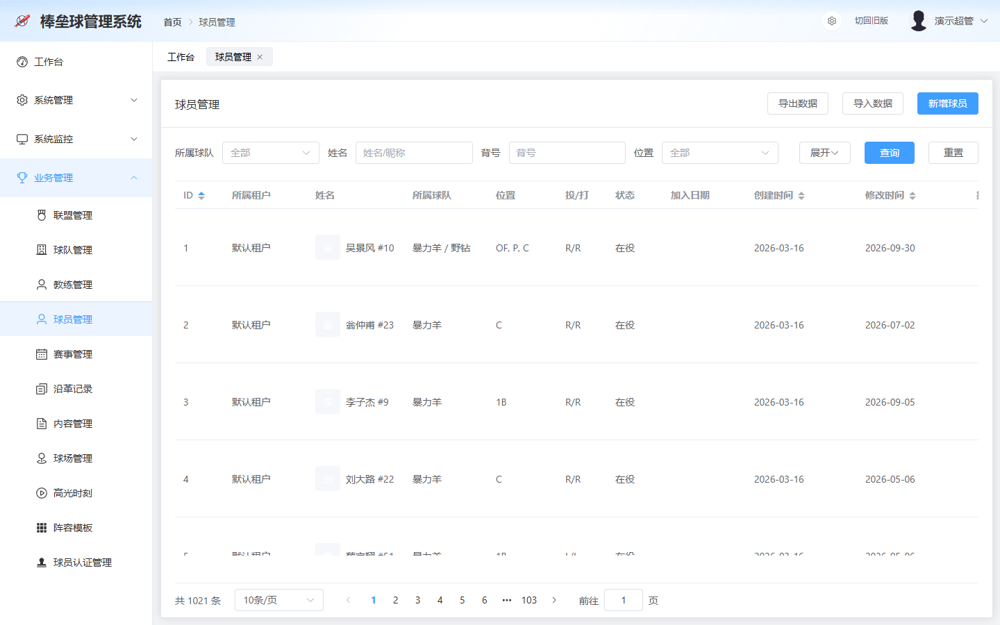

> 已认领的球员档案会在姓名列头像右下角显示一个蓝色圆形 + 白色对勾的小徽标（鼠标悬浮提示「该球员档案已被本人认领」）；未认领球员不显示。该徽标仅作提示，不改变列表操作权限。

---

## 11. 安全与数据说明

1. **读宽写窄**：公开数据人人可看；管理动作严格限域，越权返回 403。
2. **租管「删除」=归还平台**：被移除的数据不消失，由平台留存；仅平台超管有最终销毁权。
3. **退租=找不到**：租户退租后其门户路径直接 404（与"不存在"同待遇）。

---

## 12. 常见问题（FAQ）

| 问题 | 解答 |
|---|---|
| 登录后为何直接进“球队管理”而不是工作台？ | 系统自动进入你**第一个有权限**的菜单；受限角色通常不是工作台。 |
| 为什么我看不到“删除”按钮？ | 删除权按角色收窄：**球员删除仅租管/超管**（球队侧请用「移除出球队」）；球队/联盟/教练/球场/高光的删除归租管/超管，赛事/比赛删除主办方可操作。租管与超管界面均显示「删除」（租管的删除=归还平台留存）。 |
| 提示“无权代建该球员”？ | 建档仅限**自己负责的球队**：① 该球队不是你负责的球队——可新建球队（自动成为负责人），或请租管/超管为你指派该队负责人；② 受限身份不能创建“无当前球队”的球员，请先选择球队。 |
| 主办方如何成立联盟？ | 管理台 → 联盟管理 → 「申请成立联盟」→ 超管/租管在「建盟申请」中审核通过后自动成为主办方；门户**无**申请入口。 |
| 球员认领由谁审核？ | 按归属分流：球员所在队**有负责人**→该队负责人审；**无负责人**→平台/租管审。**租管=租户内超管**，可看到并代审本租户全部待办（含球队负责人类），“审核方”筛选可切换。 |
| 受限角色建档为什么必须先选“当前球队”？ | 未归属球队的球员不会出现在你的球员列表，也无法再编辑绑定（**建档即归属**）；从球队入口进入会自动带出该队。 |
| 批量导入有重复怎么办？ | 姓名+出生日期与既有档案相同者自动跳过，结果有汇总提示。 |
| 球员如何离队？ | 球员本人登录门户 → 个人资料 → 球队经历 → 取消“当前球队”。 |
| 主办方为何突然不能编辑某队了？ | 主办方仅能管理**自己负责的球队**（新建球队后自动成为负责人）；他队与无主球队请联系租管/超管指派负责人。 |
| 球队负责人“解散”球队和租管“删除”有什么区别？ | 两者都**留存数据**：解散=球队下架、队员离队，可再由管理员处置；删除=从本租户运营面移除、交还平台留存。 |
| 如何为门户角色定制本租户菜单？ | 角色管理 → 「球队负责人/赛事主办方」行 → 「租户目录」：开启覆盖并勾选菜单后保存；「清除覆盖」回落全局预设（v1.2 起交互已修复）。 |
| 认领后发现认错人了，能“解除认领”吗？ | 可以。**球员本人**：个人资料 → 我的认领（已通过）→「解除认领」；**租户管理员**：球员管理 → 已认领球员行「解除认领」；**超级管理员**任何时候可解除。解除后档案回到未认领、可重新被邀请/认领（球队经历与统计保留，并写入沿革审计）。 |

---

## 附：截图索引（测试环境实拍）

01b 门户游客 / 02 门户登录 / 03 后台登录 / 04 工作台 / 05 球队列表 / 06 新增球队(管理员) / 07 球员列表 / 08 新增球员 / 10 赛事列表 / 11 实时录入 / 12 角色列表 / 13 租户目录覆盖抽屉 / 14 平台资产 / 15 沿革记录 / 16–18 球队负责人视角 / 19–22 用户管理与建号 / 23–24 球队负责人建队 / 25 主办方登录 / 25b 主办方联盟管理 / 27 认领审核
