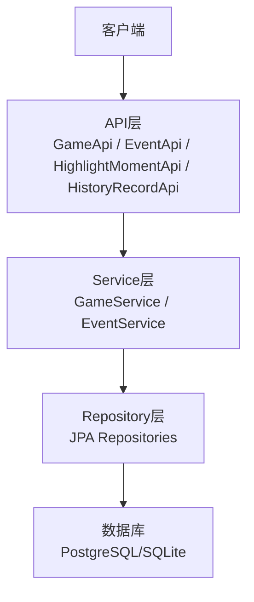
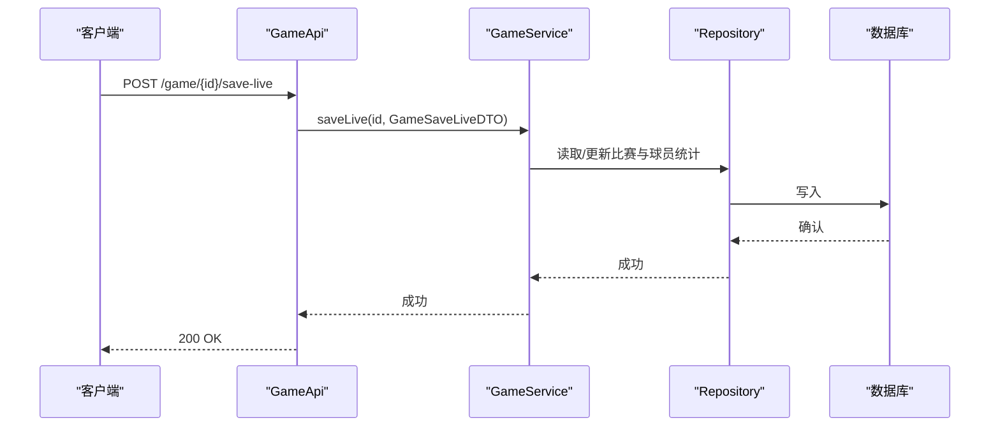
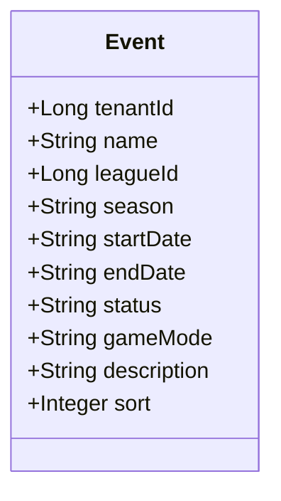
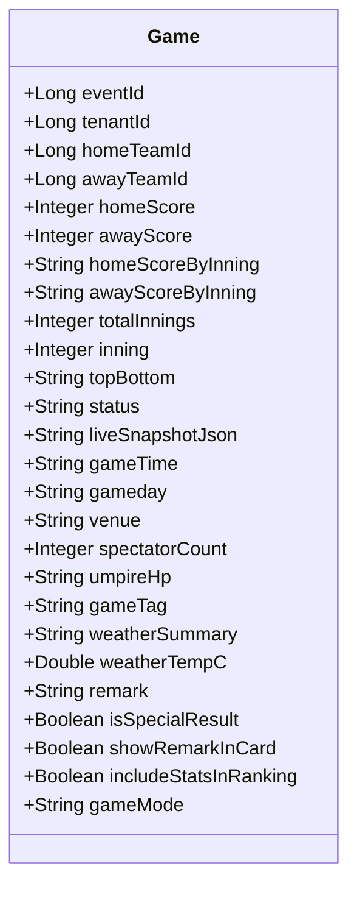
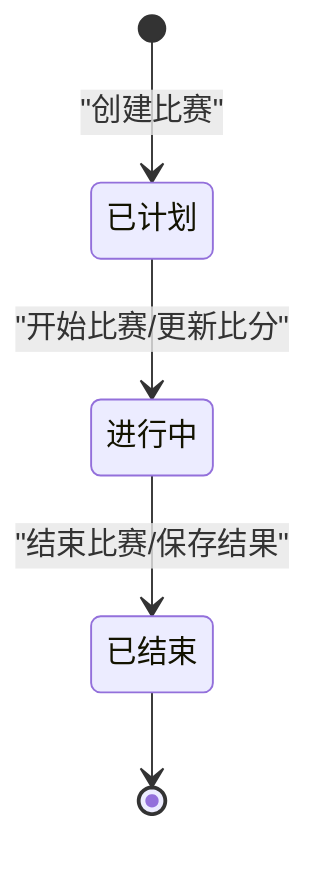
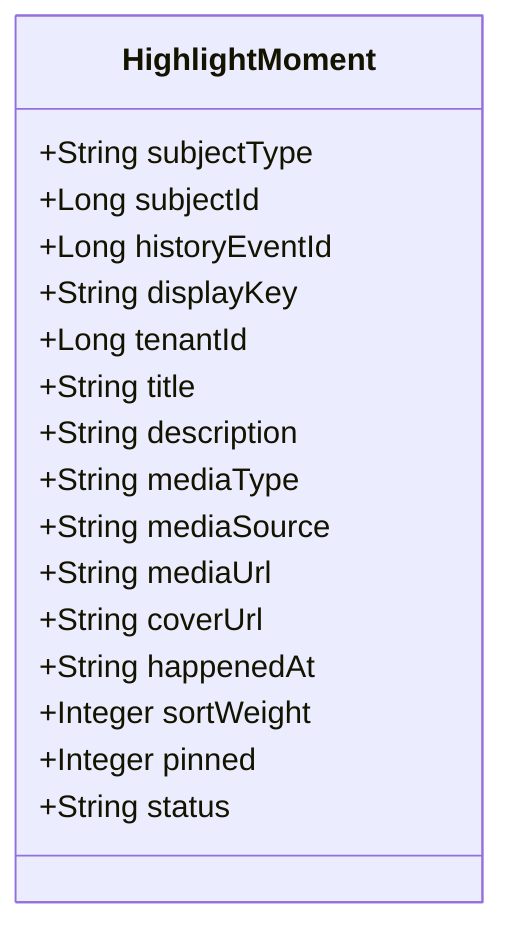
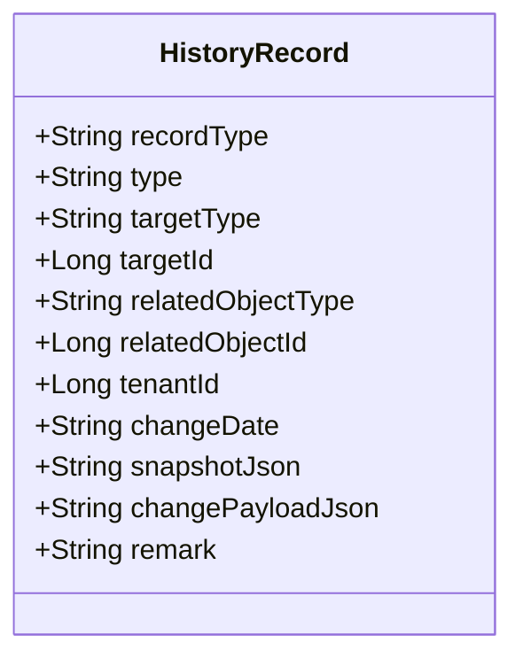
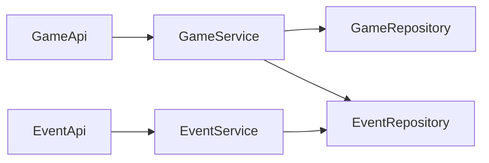

# 比赛管理API

## 目录
1. [简介](#简介)
2. [项目结构](#项目结构)
3. [核心组件](#核心组件)
4. [架构总览](#架构总览)
5. [详细组件分析](#详细组件分析)
6. [依赖关系分析](#依赖关系分析)
7. [性能与实时性](#性能与实时性)
8. [故障排查指南](#故障排查指南)
9. [结论](#结论)
10. [附录：接口清单与示例](#附录接口清单与示例)

## 简介
本文件面向“比赛管理”相关API，覆盖赛事创建、比赛安排、比分更新、比赛结果统计、历史比赛记录查询、精彩时刻标记等能力。文档从系统架构、数据模型、状态流转、CRUD操作、实时同步机制与性能优化等方面给出完整说明，并提供接口清单与调用示例路径，便于前后端对接与运维排障。

## 项目结构
- API层：提供REST接口，负责参数校验、路由分发与统一响应封装
- Service层：业务编排、权限与租户隔离、事务控制、数据一致性保障
- Repository层：数据访问（JPA）
- Model层：实体定义（如比赛、赛事、精彩时刻、历史记录）
- 公共组件：分页、统一返回体、异常处理等

## 核心组件
- 赛事管理：创建、查询、导入比赛结果
- 比赛管理：创建、更新、删除、列表查询、实时快照、比分更新、结果保存
- 精彩时刻：创建、查询、更新、删除
- 历史记录：按多维度查询人员/对象变更历史

## 架构总览
比赛管理采用分层架构：API接收请求并委托Service；Service进行权限校验、租户隔离、业务规则验证与事务控制；Repository完成持久化。关键特性包括：
- 多租户与数据范围控制：通过租户ID与联赛维度限制可访问范围
- 软删除：使用deletedAt字段实现逻辑删除
- 实时快照：比赛支持liveSnapshotJson存储实时比分与局况
- 批量结果导入：支持一次性导入比赛与球员统计数据

## 详细组件分析

### 赛事管理（Event）
- 功能：赛事的增删改查、按联赛与租户过滤、导入比赛结果
- 权限：基于租户与联赛的数据范围控制
- 状态：默认draft，可按需推进
- 详情附带：GET /event/{id} 响应新增 `specialRules` 字段（联赛特殊规则生效值，瞬态、仅详情接口返回；Issue #275，见文末「联赛特殊规则开关与 EP 制」）

### 比赛管理（Game）
- 功能：创建、更新、删除、列表查询、获取/保存实时快照、比分更新、结果保存、球员统计CRUD
- 状态：status默认scheduled，支持实时更新；inning/topBottom表示当前局与上下半局
- 实时：liveSnapshotJson用于前端轮询或推送展示实时比分
- 统计：每场比赛的球员统计数据独立维护

#### 比赛状态流转

### 精彩时刻（HighlightMoment）
- 功能：创建、查询、更新、删除
- 用途：标记比赛中的高光片段，支持媒体类型与排序权重

### 历史记录（HistoryRecord）
- 功能：按目标类型、关联对象、时间范围等多维度查询变更记录
- 用途：审计与回溯，支持快照与变更内容JSON

## 依赖关系分析
- API到Service：单向依赖，职责清晰
- Service到Repository：通过JPA进行数据访问
- 权限与租户：Service层集成DataScopeService与TenantQueryPolicyService，确保数据隔离
- 事件与比赛：比赛通过eventId关联赛事，保证上下文一致

## 性能与实时性
- 分页与排序：所有列表接口均支持page、pageSize、sortProp、sortOrder，避免全表扫描
- 条件查询：支持按赛事、年份、球队等多维过滤，减少不必要数据加载
- 实时快照：通过GET/POST /game/{id}/live-snapshot实现轻量级实时比分拉取与更新，适合前端轮询或WebSocket推送
- 批量更新：save-live与save-result支持增量更新比分与统计，降低写放大
- 软删除：使用deletedAt过滤，避免物理删除带来的索引与关联问题
- 建议优化：
  - 对高频查询字段建立复合索引（如tenantId、eventId、gameday）
  - 对liveSnapshotJson做合理分片或缓存策略，避免大对象频繁落库
  - 对统计写入采用批处理或异步队列，削峰填谷

[本节为通用性能建议，不直接引用具体代码行]

## 故障排查指南
- 常见错误码与场景
  - 400 非法参数或缺少必要字段：检查请求体结构与必填项
  - 403 无权限：确认租户与联赛数据范围，检查用户角色与授权
  - 404 资源不存在：核对ID有效性，注意软删除导致不可见
- 定位步骤
  - 查看API日志与Service异常堆栈
  - 检查Repository SQL执行计划与索引命中
  - 核对租户ID、联赛ID、赛事ID是否匹配
- 典型问题
  - 无法修改比赛：可能因非所属租户或已被删除
  - 导入结果失败：校验先发起守备位置唯一性与打序人数要求
  - 实时快照未生效：确认保存接口调用成功且JSON格式正确

## 结论
本套比赛管理API以清晰的层次划分、严格的权限与租户隔离、完善的实时比分与结果管理能力，支撑了从赛事规划到比赛执行与复盘的全流程。通过分页、条件查询与批量更新等手段，兼顾了易用性与性能。建议在部署时结合索引与缓存策略进一步优化高并发场景下的读写性能。

[本节为总结性内容，不直接引用具体代码行]

## 附录：接口清单与示例

### 赛事（Event）
- GET /event/list?page=&pageSize=&sortProp=&sortOrder=
  - 作用：分页查询赛事列表
  - 参考：`EventApi.java:51-55`
- GET /event/{id}
  - 作用：获取单个赛事详情
  - 响应：附带 `specialRules` 字段（`{extraBatter, forceHalf}` 联赛特殊规则生效值；未挂联赛 / 无记录按默认兜底；Issue #275，见文末专题）
  - 参考：`EventApi.java:57-64`
- POST /event/create
  - 作用：创建赛事
  - 参考：`EventApi.java:66-70`
- PUT /event/update/{id}
  - 作用：更新赛事
  - 参考：`EventApi.java:78-82`
- DELETE /event/delete/{id}
  - 作用：删除赛事（软删除）
  - 参考：`EventApi.java:84-88`
- POST /event/{eventId}/import-game-result
  - 作用：导入比赛结果（含比赛与统计）
  - 参考：`EventApi.java:72-76`

### 比赛（Game）
- GET /game/list?page=&pageSize=&sortProp=&sortOrder=&eventId=&eventIds=&years=&teamId=
  - 作用：分页查询比赛列表，支持多维过滤
  - 参考：`GameApi.java:62-69`
- GET /game/{id}
  - 作用：获取比赛详情
  - 响应字段 `engineManaged`：该场是否已有 ER 引擎事件；`true` 时前端把 `ER`/`R` 视为引擎只读字段
  - 参考：`GameApi.java:71-75`
- GET /game/{id}/live-snapshot
  - 作用：获取实时快照（比分、局况等）
  - 参考：`GameApi.java:77-81`
- POST /game/{id}/live-snapshot
  - 作用：保存实时快照
  - Issue #234：`snapshotJson` 内增加 `activeAbContext`、`pendingAtBatResultCode`、`pendingAtBatResultText`，保存打席开始时的垒况、球数、比分、守备位置及待定结果；同样写入撤销/重做帧。旧快照缺少这些字段时按恢复现场初始化上下文，无法补出原打席开始状态。接口仍使用 `{snapshotJson}` 包装，不新增表字段。
  - 参考：`GameApi.java:83-87`
- POST /game/create
  - 作用：创建比赛
  - 参考：`GameApi.java:95-99`
- PUT /game/update/{id}
  - 作用：更新比赛
  - 参考：`GameApi.java:101-105`
- POST /game/{id}/save-live
  - 作用：更新比赛实时比分与部分统计
  - ER 单一写方：若该场已有 `bs_earned_run_play`，请求里的 `er` 被忽略；`pitchR/ER/UER/PENDING` 只由 ER 引擎写。无引擎数据的 legacy 场次仍接受 `er`
  - 纸质表单字段（Issue #347）：打者新增 `io`；投手新增 `pitchDoubles/pitchTriples/pitchSh/pitchSf/pitchIo`，并接收 `pitchBb/pitchIbb/pitchHbp` 分项。`bb`/`pitchBb` 含 IBB；`bbHp=bb+hbp`，`pitchBbHp=pitchBb+pitchHbp`
  - 盒子比分守备表（关联 #446）：`stats` 新增 `firstPosition`（本场首次上场防守的守位，后续换位不覆盖；DH/PH/EP 为空；旧客户端缺栏保留库中原值）。仅在实际守备/换守备落位时写入，代打/代跑未防守前不继承被换下者守位
  - 换人事务（2026-10-27）：可选 `substitutions` 数组，与 `stats` 同一事务落 `bs_game_substitution_event`；同一 `transactionId` 重试幂等。元素字段：`transactionId/teamId/inning/topBottom/changeType/slot/outPlayerId/inPlayerId/outPosition/inPosition`；`changeType` 为 `SUBSTITUTION/POSITION_CHANGE/PITCHING_CHANGE/DH_CANCEL`。事件只记录净变化，统计事实仍以 `stats` 为准
  - 实时自动写：LiveGame 已自动累加 IBB/BB/HBP 分项、GDP、DP、INN、PB、SB允许、CS、GO/FO、投手 2B/3B/SH/SF/IO 与捕手妨碍 IO；首名投手自动标记 GS。W/L/SV/HLD 仍由管理端补录
  - 参考：`GameApi.java:107-111`
- POST /game/{id}/earned-runs/reconstruct
  - 作用：全量替换并重建指定半局的 ER/UER 判定，返回逐分结果与责任投手汇总
  - 请求：`inning`、`half`（`top`/`bottom`）及按 `sequence` 严格递增的完整 `plays` 列表
  - 判定输入：得分跑者可携带 `wouldScoreWithoutMisplay`（布尔，可空）——记录员对「若没有捕逸等防守失误，该跑者是否仍会得分」的判断；传 `null` 或省略时，捕逸得分保留为 `PENDING` 待人工覆核
  - 注意：该接口不是增量追加；判决待定时应传 `rulingPending=true`，结果会保留为 `PENDING`
  - 累计：按该半局新旧判定差额同步更新责任投手的 `pitchR`、`er`、`unearnedR` 与 `pendingR`，重放不会重复累计；责任投手统计列不存在时自动补建（teamId 取该半局守备方）
  - 响应新增 `pitcherAbsoluteTotals`：每投手应用本次差额后的库内绝对 R/ER/UER/PENDING；前端只覆盖、不累加。旧响应缺少该字段时前端不做本地 ER 变更
  - 权限：沿用比赛写入权限、租户隔离与赛事数据范围校验
- POST /game/{id}/save-result
  - 作用：保存比赛最终结果与统计
  - P/DH 强校验（#478）：`save-result` 与 `import-game-result` 中，同一球队的打击行（`battingOrder>0`，含 `isPitcher=1` 的二刀流合并行）不可同时出现 DH 与打击投手（P）；同一球员既列 DH 又列投手（规则 5.11(b) P/DH 二刀流）放行。门控：`save-result` 仅当库内与本次请求状态都为 `final`（纯赛后补录）时跳过；同请求置 `status=final` 或 final 重开 live 均照常校验。`import-game-result` 仅在导入进行中场次时校验（缺省落 final，特殊赛果不校验）
  - ER 单一写方：引擎场次忽略请求里的 `er`/`pitchR`；legacy 无引擎数据场次仍允许手工修正
  - 行删除语义：`stats` 未出现但未列入 `removedStatIds` 的既有行一律保留；只有 `removedStatIds` 显式列出的既有统计行才物理删除。同一行同时出现在 `stats` 与 `removedStatIds` → 400；`removedStatIds` 含本场不存在的 id 或 null 时忽略，重复 id 只删一次。结果页删除打者/投手时由前端带上被删的 `statId`（删除后又补录同一球员则不再提交），旧页面漏带不再触发删除
  - 引擎场次投手行经 `removedStatIds` 删除时仍要求全零且无自责分判定，否则 400（先转记 / 先处理判定）；全零判定不含 `pitchPa`
  - 纸质表单字段（Issue #347）：`StatPart` 新增 `io/pitchDoubles/pitchTriples/pitchSh/pitchSf/pitchIo`；结果页四栏同送数字（`pitchBb/pitchIbb/pitchHbp/pitchBbHp`），后端对缺栏保留既有值、显式 0 清零（#387/#459）
  - 注：`gameNumber`（场次）与 `venue`（场地）为整字段覆盖——请求体传 null 或省略即视为清空（用于前台不显示场次/场地，issue #28）；其余比分/统计字段仍为增量更新
  - 参考：`GameApi.java:113-117`
- DELETE /game/delete/{id}
  - 作用：删除比赛（软删除）
  - 参考：`GameApi.java:119-123`
- GET /game/{gameId}/stats
  - 作用：查询某场比赛的球员统计
  - 响应：`PageResult<GamePlayerStat>`；V20261028100000 起含 `firstPosition`（首次上场守位，旧数据为空时前端回退 `position` 展示）
  - 参考：`GameApi.java:89-93`
- GET /game/{gameId}/substitutions
  - 作用：按全场 `sequence` 查询换人事务事件（`bs_game_substitution_event`），用于审计、箱线图换人顺序与现场重建
  - 响应：`PageResult<GameSubstitutionEvent>`（`list/total`）；字段见数据模型「换人事务事件（GameSubstitutionEvent）」
- POST /game/stats/create
- PUT /game/stats/update/{id}
- DELETE /game/stats/delete/{id}
  - 作用：球员统计CRUD
  - 引擎场次（已有 `bs_earned_run_play`）：create 把 R/ER/UER/PENDING 归零；update 保留四个字段并拒绝修改比赛/球员/投手身份；delete 对投手行要求“全零且无自责分判定”，否则返回 400（先转记数据 / 先处理判定）；零数据投手行允许删除
  - 全零判定不包含结果页不暴露的辅助字段 `pitchPa`（投手面对打者以 `pitchBf` 为准；`pitchPa` 非零但 `pitchBf` 为 0 时仍按零数据清理）；`pitchBf`、用球数、安打、失分等实际统计仍参与
  - 参考：`GameApi.java:125-141`

### 精彩时刻（HighlightMoment）
- GET /highlight-moment/list?page=&pageSize=&sortProp=&sortOrder=&subjectType=&subjectId=&mediaType=&status=
  - 作用：分页查询精彩时刻
  - 参考：`HighlightMomentApi.java:46-49`
- POST /highlight-moment/create
  - 作用：创建精彩时刻
  - 参考：`HighlightMomentApi.java:51-55`
- PUT /highlight-moment/update/{id}
  - 作用：更新精彩时刻
  - 参考：`HighlightMomentApi.java:57-61`
- DELETE /highlight-moment/delete/{id}
  - 作用：删除精彩时刻
  - 参考：`HighlightMomentApi.java:63-67`

### 历史记录（HistoryRecord）
- GET /history-record/list?page=&pageSize=&sortProp=&sortOrder=&targetType=&targetId=&relatedObjectType=&relatedObjectId=&type=&recordType=&dateFrom=&dateTo=
  - 作用：分页查询历史记录
  - 参考：`HistoryRecordApi.java:40-44`
- POST /history-record/create
  - 作用：创建历史记录
  - 参考：`HistoryRecordApi.java:46-50`

## 阵容保存与秩序册校验（电子秩序册，Issue #310）

赛事存在任意参赛记录（含仅邀请）后即为「受限赛事」：其比赛录入阵容与统计写入仅可使用各队报名球员。

### 端点

| 方法 | 路径 | 用途 | 说明 |
|---|---|---|---|
| POST | /game/{id}/lineup-snapshot | 阵容专用保存（门①） | body `{snapshotJson}` 同 `/{id}/live-snapshot`；受限赛事解析快照中 `homeLineup/awayLineup/homeBench/awayBench/homeFieldingPitcherId/awayFieldingPitcherId/homeLastDhAddedFromPoolId/awayLastDhAddedFromPoolId` 的球员 id，按主客队分别校验 ⊆ 该队有效报名名单；违规 400（消息含球员名与球队名）。阵容板保存/开始录入走此端点；比赛进行中的高频自动保存仍走 `/{id}/live-snapshot`（不解析校验） |

### 统计写入门（门②）

- `POST /game/{id}/save-live`（stats 部分）、`POST /game/{id}/save-result`（stats 部分）、`POST /game/stats/create`、`PUT /game/stats/update/{id}`：受限赛事下逐条校验 `(teamId, playerId)`。
- **首次引入口径**：仅拦截「为本场首次引入的名单外球员」——若 `(gameId, teamId, playerId)` 已有有效统计行，其更新不受限（保护进行中比赛与历史修正）。
- 违规 400：「球员「X」未在本赛事秩序册名单中，无法记入比赛数据」。
- `save-result` 若同请求迁移 eventId，按**目标赛事**口径校验（`dto.game.eventId` 优先）。
- 无赛事（eventId 为空）或赛事无参赛记录 → 全部跳过（现行为不变）。

### 选人池端点

- `GET /event/{eventId}/teams/{teamId}/roster-players`（见《球队球员API》电子秩序册小节）：受限=报名名单；未受限=本队 current 全量在役。

### 排赛报名制门槛（Issue #318 决策 8/11）

- 赛事结束校验（决策 7）：`PUT /event/update/{id}` 将状态由非 ended 置为 ended 前，校验该赛事未删比赛全部为终态（final 已结束 / cancelled 取消，与球队解散守卫同口径），否则 400「存在未结束的比赛，无法结束赛事」；反向（ended→其它）不拦。
- 报名制门槛（决策 11）：`bs_event.require_roster=true`（新建赛事默认）时，建比赛/改主客队/`save-result` 改主客队/`import-game-result` 导入建比赛统一校验——该赛事「已确认且锁定名单」球队数 < 2 → 400「该赛事需至少两支球队完成报名（确认并锁定名单）后才能安排比赛」；主/客队须属该集合，否则 400「主/客队须为本赛事已完成报名的球队」。
- 历史赛事（require_roster=false）不校验（决策 8 宽松口径，照顾存量比赛）。
- `require_roster` 创建时定型：编辑赛事一律沿用存量值（无 UI 开关，防请求体缺省把存量 false 赛事翻转）。
- 排赛选队候选：`GET /event/{eventId}/game-team-options`（见《球队球员API》）；联盟解散守卫同步改为「名下赛事全部 ended 才可解散」（决策 6）。

## 特殊规则：联赛收费能力 + 赛事级规则（Issue #275 / #274）

2026-10-24 口径调整：特殊规则改为两层——
1. 联赛收费能力 `special_rules_enabled`（租户管理员/超管在联赛编辑弹窗开启）；
2. 赛事级实际规则 `extra_batter` / `force_half`（赛事编辑弹窗配置）。
已配置规则的赛事在联赛能力关闭后保留规则；该联赛新建赛事不再提供特殊规则开关。

### 联赛收费能力（联赛级）

| 方法 | 路径 | 用途 | 说明 |
|---|---|---|---|
| GET | /league/{id}/special-rules | 读取生效值（含能力与旧规则默认兜底） | 响应 `Result<Map>`，形状 `{rules:{specialRulesEnabled:boolean, extraBatter:boolean, forceHalf:boolean}}`；`specialRulesEnabled` 无记录默认 false |
| PUT | /league/{id}/special-rules | 更新能力（支持子集 / 全集） | body `{rules:{specialRulesEnabled:boolean}}`；未知键名 / 非布尔值 / 空映射 400，联赛不存在或已软删 404，跨租户 403；`extraBatter`/`forceHalf` 键保留 deprecated（不再影响赛事） |

- 权限点：`business:league:specialRule`（联赛编辑弹窗「特殊规则能力」入口 + 两接口注册）；租管仅可操作本租户联赛，超管可跨租户。
- 迁移 `V20261025100000__event_special_rule.sql`：旧 `extra_batter` / `force_half` 行复制到该联赛下每个赛事；对存在旧规则行的联赛写入 `special_rules_enabled=true`（保持现状）。

### 赛事级规则

- 存储：`bs_event_special_rule`（唯一约束 `(event_id, rule_key)`）；默认 extraBatter=false、forceHalf=true。
- `GET /event/{id}` 的 `specialRules`：`{specialRulesEnabled:boolean, hasEventRules:boolean, extraBatter:boolean, forceHalf:boolean}`；已有规则赛事能力关闭时仍返回并生效。
- `PUT /event/update/{id}` 请求可携带 `specialRules:{extraBatter, forceHalf}`：
  - 赛事已有规则（hasEventRules）→ 允许写入（能力关闭也保留）；
  - 无既有规则 → 要求赛事挂联赛且 `specialRulesEnabled=true`，否则 400「该联盟未开放特殊规则能力」。
- `POST /event/create` 携带规则时同样要求联赛能力开启；不携带则按默认。
- 权限点：复用 `business:event:edit`（赛事编辑入口）。
- 消费口径（编辑先发阵容页 / 实时录入页 / 结果录入页）：`extraBatter` 关闭 → 棒球阵容恰 9 人、垒球恰 10 人；开启 → 棒球 9-12 人（八守位各 1 + P/DH 至少其一 + EP 至多 3，EP 不守备只打击）、垒球 10-11 人；`forceHalf` 关闭 → 实时录入页隐藏「强制换局」按钮。已保存数据不回溯。

---

> 本文整理自 Qoder RepoWiki（基于代码自动生成），仅供参考，以代码为准。
