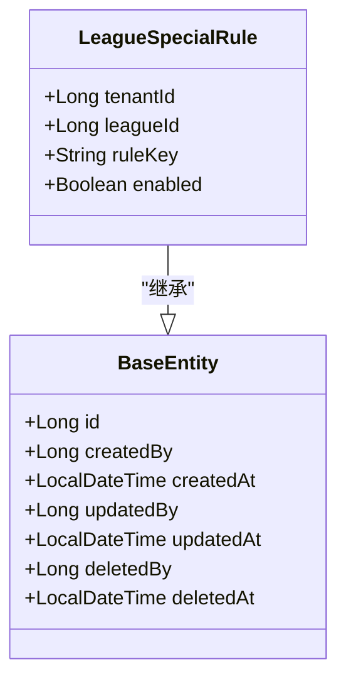

# 联赛特殊规则实体（LeagueSpecialRule）

## 简介
本文件说明联赛级特殊规则开关（Issue #275）：`extra_batter`（EP 制 / 额外打击者）与 `force_half`（强制换局）。语义铁律：**行存在 = 以记录为准（支持显式关闭）；无记录 = 默认值（extra_batter=false、force_half=true）**。规则行只写不删：无软删语义，deleted_* 恒空。文档以代码为依据。

## 项目结构
- 实体层：LeagueSpecialRule（继承 BaseEntity 审计基类）
- 数据访问层：LeagueSpecialRuleRepository（findByLeagueId / findByLeagueIdAndRuleKey）
- 服务层：LeagueSpecialRuleService（读取生效值含默认兜底 / 写入按行 upsert；API 键（camelCase）与 DB 规则键（snake_case）映射、默认值集中定义）
- 接口层：LeagueApi（GET/PUT /league/{id}/special-rules）；消费侧 EventService.get 随赛事详情附带 specialRules 生效值
- 迁移：`db/migration/postgresql/V20261015100000__league_special_rule.sql`（建表 + 存量白名单回填，幂等）

## LeagueSpecialRule（表 bs_league_special_rule，联赛级特殊规则开关）
- 字段要点
  - 归属：tenantId（租户ID）、leagueId（联赛ID，逻辑关联 bs_league.id，无外键约束）。
  - 规则键 ruleKey（VARCHAR(64)，非空）：`extra_batter`（EP 制 / 额外打击者）/ `force_half`（强制换局）。
  - 开关 enabled（BOOLEAN 非空，默认 FALSE）：是否启用。
  - 审计：createdBy/createdAt/updatedBy/updatedAt/deletedBy/deletedAt（继承 BaseEntity；规则行只写不删，deleted_* 恒空）。
- 取值语义
  - 无记录 = 默认值（extra_batter=false、force_half=true）；有记录 = 以记录为准（支持显式关闭）。
  - 未挂联赛的赛事（leagueId 为空）直接返回默认值，不查库；DB 中未知 rule_key 读取时忽略。
- 索引
  - 唯一约束：`(league_id, rule_key)`（uk_bs_league_special_rule）。
- 生命周期
  - 按行 upsert：行存在则原地更新 enabled 与 updatedBy（保留 createdBy），不存在则新增；写入不删除行。

## 关联与口径
- League 1—N LeagueSpecialRule（联赛级开关按 leagueId 归档）；赛事经 `Event.leagueId` 取值，随 `GET /event/{id}` 详情响应附带 `specialRules: {extraBatter, forceHalf}`（瞬态字段，未挂联赛 / 无记录按默认兜底）。
- 存量白名单回填（同迁移文件，幂等）：打序统计（棒球 batting_order>9 / 垒球 >10）∪ 阵容快照（homeLineup/awayLineup 数组长度超默认，jsonb 判型守卫）双证据 → 经 bs_event 取 league_id → 回填 `extra_batter=true`；`WHERE NOT EXISTS` 去重，未挂联赛赛事跳过；软删行不计证据。
- 消费口径（Issue #274）：extra_batter 关闭 → 棒球阵容恰 9 人 / 垒球恰 10 人；开启 → 棒球 9-12 人（EP 组合矩阵：八守位各 1 + P/DH 至少其一 + EP 至多 3）、垒球 10-11 人；force_half 关闭 → 实时录入页隐藏「强制换局」按钮。已保存数据不回溯。

## 约束与校验
- 写入校验（服务层）：未知规则键 / 非布尔 JSON 值 / 缺失值 / 空映射 → 400；联赛不存在或已软删 → 404。
- 写守卫：租户上下文缺失 → 403（fail-closed）；租管仅可操作本租户联赛（跨租户 403），超管可跨租户；再经 ResourceGuard.assertCanManageLeague 拦截同租户内受限身份。
- 权限点：`business:league:specialRule`（联赛目录「特殊规则」按钮种子 + 两接口 ApiDef 注册；前端按 hasPerm 控制按钮显隐）。

> 本文以代码为准（LeagueSpecialRule.java / LeagueSpecialRuleService.java / LeagueApi.java / EventService.java / V20261015100000__league_special_rule.sql）。
