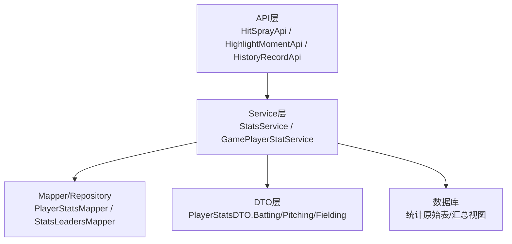
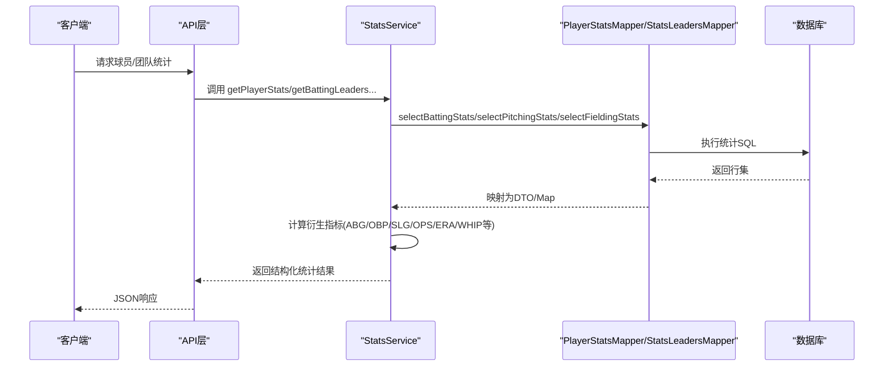
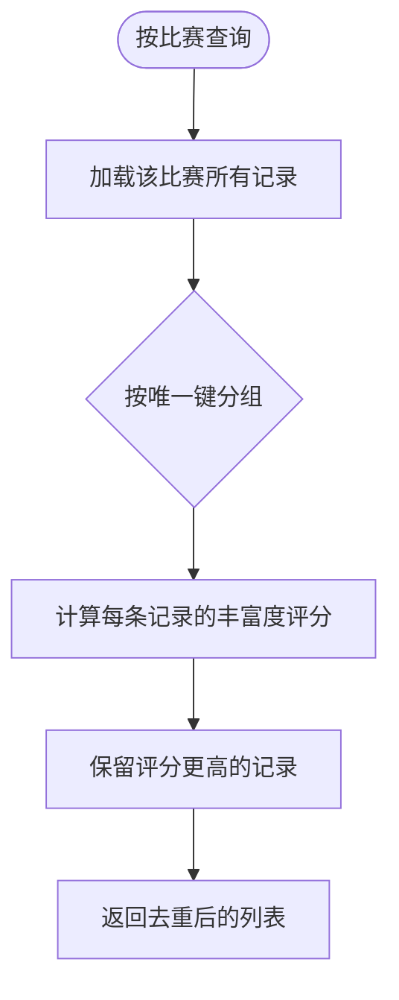
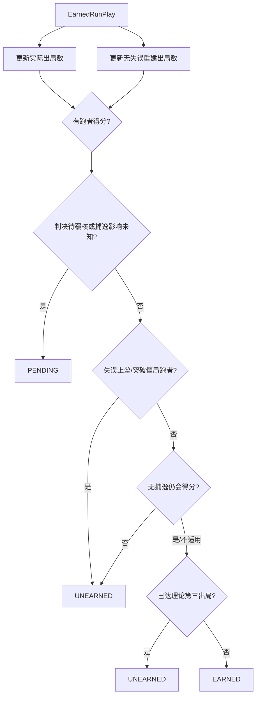
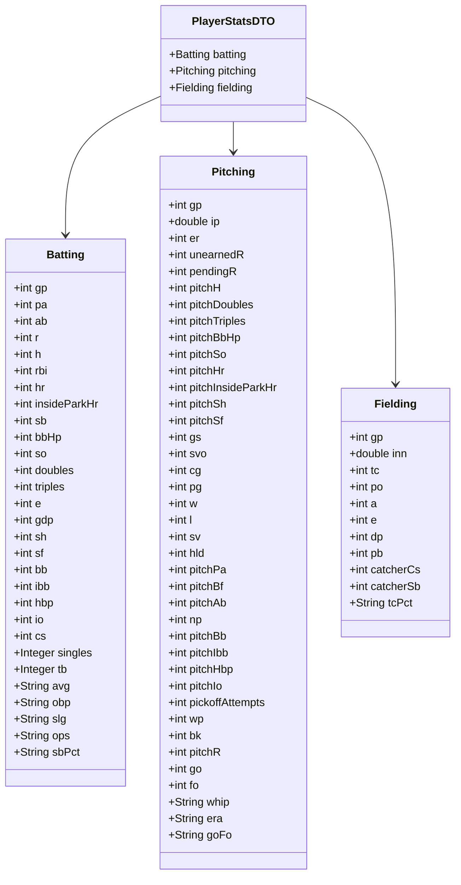
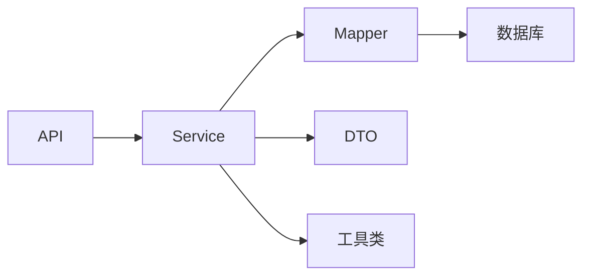

# 统计实体

## 目录
1. [简介](#简介)
2. [项目结构](#项目结构)
3. [核心组件](#核心组件)
4. [架构总览](#架构总览)
5. [详细组件分析](#详细组件分析)
6. [依赖关系分析](#依赖关系分析)
7. [性能考虑](#性能考虑)
8. [故障排查指南](#故障排查指南)
9. [结论](#结论)
10. [附录](#附录)

## 简介
本文件聚焦于棒球统计实体的数据模型与计算逻辑，覆盖比赛球员统计数据（GamePlayerStat）、击球热区（HitSpray）、精彩时刻（HighlightMoment）、历史记录（HistoryRecord）等关键实体。文档重点说明：
- 字段定义与业务含义（含击球率、本垒打数、防守数据等专业指标）
- 统计数据的聚合计算与展示格式
- 缓存策略与性能优化建议
- 历史数据归档、报表生成与导出支持
- 统计查询的SQL优化与索引设计建议

## 项目结构
围绕统计能力的相关代码主要分布在以下层次：
- API层：暴露统计相关接口（如击球热区、精彩时刻、历史记录）
- Service层：负责统计聚合、格式化、分页与排序
- DTO层：承载对外展示的统计结果（击球/投球/防守三维度）
- Repository/Mapper层：提供数据访问与复杂查询（由服务调用）

**图示来源**
- `HitSprayApi.java:35-65`
- `HighlightMomentApi.java:41-67`
- `HistoryRecordApi.java:35-55`
- `StatsService.java:80-110`
- `GamePlayerStatService.java:20-34`

## 核心组件
- 比赛球员统计数据（GamePlayerStat）
  - 用于记录单场比赛中每位球员的击球、跑垒、防守、投球等多维原始统计
  - 服务层提供按比赛查询、去重与“丰富度”择优策略，保证同一角色在同一比赛中保留信息更完整的记录
- 击球热区（HitSpray）
  - 通过API提供保存、批量保存与按比赛/球员/队伍查询的能力，支撑可视化与战术分析
- 精彩时刻（HighlightMoment）
  - 提供列表、创建、更新、删除等基础CRUD能力，支持按主题类型、媒体类型、状态等筛选
- 历史记录（HistoryRecord）
  - 提供分页列表与创建能力，支持按目标类型、关联对象、记录类型、时间范围等条件检索，便于审计与回溯

## 架构总览
统计能力以Service为核心，聚合来自Mapper的数据并转换为统一的DTO结构，再经API暴露给前端或外部系统。

**图示来源**
- `StatsService.java:93-110`
- `StatsService.java:663-726`

## 详细组件分析

### 比赛球员统计数据（GamePlayerStat）
- 职责
  - 存储每场比赛的球员原始统计（击球、跑垒、防守、投球）
  - 提供按比赛查询与去重策略，确保同一角色在同一比赛中仅保留信息最完整的一条
- 关键字段（示例）
  - 击球/跑垒：PA、AB、R、H、RBI、HR、InsideParkHR、SB、SO、Doubles、Triples、BB、IBB、HBP、IO、CS、SH、SF、E、GDP
  - 投球：IP、ER、PitchH、PitchDoubles、PitchTriples、PitchSh、PitchSf、PitchBbHp、PitchSo、PitchHr、PitchInsideParkHr、PitchIo、PickoffAttempts、Np、Wp、Bk、PitchPa、PitchBf、PitchAb、PitchR、Go、Fo
  - 牵制企图（V20261112100000 新增）：`pickoff_attempts` 记录投手在两次投球之间向垒上牵制投球的次数；同垒牵制的未果回垒、牵制出局、暴传失误均计 1，捕手牵制不计。属于内部辅助统计，不在 WBSC 官方基础统计清单内；`save-live`/`save-result` 缺栏时保留库中原值
  - 防守：PO、A、TC、DP、INN、PB、CatcherSb、CatcherCs
  - 角色标识：IsPitcher、BattingOrder、PitcherOrder、ListOrder、Position、FirstPosition、StartingPosition
  - FirstPosition（V20261028160000 新增）：本场首次上场防守时的守位，用于盒子比分守备表归组；
    之后场上换位不更新。DH/PH/EP 不守备，该列为空；旧数据为空时前端回退 Position 并按守备证据过滤代打/代跑。
  - StartingPosition（V20261031100000 新增）：本场先发守备位（先发野手/先发投手；DH、替补、PH/PR 为空）。
    守备表组首优先取 `StartingPosition=该守位` 的先发者，组按组首棒次排序、替补缩进；旧数据为空时回退棒次/列表序。
  - 守备汇总口径：仅取 Position 非空且非 DH/PH/EP 的行；以 `IsPitcher=0` 的球员行为主（GP 按场去重），
    `Position=P` 照常计入（野手改投后整行守备数据不丢失）；投手并行行（`IsPitcher=1`）仅在该球员本场
    没有带守备数据（TC/PO/A/E/DP/PB/CS/SB/INN/GS）的可计入球员行时补计，补计需上述任一项有值，避免二刀流重复累计。
    显式按 P 筛选时零动作投手行也补入，但同位置已有带数据球员行时不重复；新增复合索引 `(game_id, player_id, team_id, is_pitcher)` 支撑该去重查找。
  - 捕手专项：PB/CS/SB 按行无条件累计（捕手后改投不会丢失）；按 C 筛选时同时纳入 `FirstPosition='C'` 或 PB/CS/SB 有值的球员。
- 去重与丰富度评分
  - 构建唯一键：基于比赛ID、队伍ID、球员ID、是否投手、击球顺序、投球顺序、名单顺序、位置
  - 丰富度评分：对关键统计字段非空计数，选择更“丰富”的记录作为最终值
- 典型流程

**图示来源**
- `GamePlayerStatService.java:24-34`
- `GamePlayerStatService.java:54-91`

### 逐位置守备统计（GameFieldingPosStat）

- 表名：`bs_game_fielding_pos_stat`
- 职责：记录每场每队每球员在某个守位的守备出局数，作为按位置排行与后续逐位置守备指标（PO/A/E 等）的事实来源
- 关键字段
  - `game_id/team_id/player_id/tenant_id`
  - `position`：守位；`DH/PH/EP` 不入表
  - `outs`：该位置累计守备出局数（3 outs = 1 局）
  - `po/a/e`：该位置累计接杀/助杀/失误数（P3；`tc = po+a+e` 不落库，由查询派生）
  - `dp/pb/catcher_cs/catcher_sb`：该位置累计双杀/捕逸/盗垒阻杀/被盗垒数（P3 扩展指标）
  - `fielding_gs`：该位置是否先发
  - `source`：`LIVE/DERIVED/MANUAL`
- 约束/索引
  - `(game_id, team_id, player_id, position)` 唯一（`deleted_at IS NULL`）
  - 排行查询索引 `(tenant_id, position, player_id)` 与球员维度 `(tenant_id, player_id, position)`
- 口径
  - 每个守备出局给当前在场守备员按其守位 +1；换位/代守/换投从新位置起算，旧位置保留
  - `po/a/e` 按记账时球员所在守位累计：传球链（PO/A）、失误责任员（E）、三振/牵制/盗垒死（PO）均走同一位置键；换位后新位置从 0 起算
  - `dp` 记参与双杀的守位（同场同位置去重一次）；`pb/catcher_cs/catcher_sb` 统一记捕手 C 位
  - 同一球员同一场 `sum(outs)` 与实时 `fielding.ip` 的 out 数一致；`sum(po/a/e)`、`sum(dp/pb/catcher_cs/catcher_sb)` 与球员级守备总数一致
  - `bs_game_player_stat.def_inn` 为球员级汇总，由 `sum(outs)` 换算（10 outs → 3.1）；旧场次无逐位置数据时仍按原口径展示
  - 赛前保存/开始录入不自动补行；逐位置数据随 `save-live` 的 `fieldingPositions` 全量替换
  - 读取顺序：`GET /game/{gameId}/fielding-positions` 按 `team_id, player_id, id` 升序；`save-live` 全量替换时按请求数组顺序（前端 `byPos` 首次触达顺序）插入，故 `id` 保留球员逐位置首次触达顺序
  - 详情展示（#524）：仅当球员有 ≥2 个有效逐位置明细，且 PO/A/E/DP/PB/SB/CS 与 `sum(outs)` 均与球员级汇总行一致时，守备表主行显示合计（POS 留空）并可展开逐位置明细；明细 GS 按 `startingPosition` 判定（旧数据回退 `fielding_gs`）。历史场次、赛后手工录入无逐位置数据时不展开，继续按汇总行展示
- 扩展：后续新增指标可直接加列，无需新表

### 守备补记（GameFieldingAdjustment）

- 表名：`bs_game_fielding_adjustment`（Flyway `V20261103100000`）
- 职责：记录赛后复盘时，对「接球失误导致本应完成的出局未发生」补记的助杀 A；独立于 ER 判定表，避免 ER 按半局删除重建时被覆盖
- 关键字段
  - `game_id/tenant_id/team_id/player_id`
  - `source_event_id`：源 Play 的稳定 `id`；`source_sequence/inning/top_bottom`：源 Play 定位快照
  - `position`：补记守位（P/C/1B/2B/3B/SS/LF/CF/RF）
  - `assist_count`：补记助杀数（当前固定 1）
  - `status`：`APPROVED/REVOKED/INVALIDATED`；撤销与失效都保留审计行
  - `source_text`：源 Play 文本快照；`note`：记录员备注
  - `revoked_by/revoked_at`：撤销审计；`invalid_reason`：失效原因（完整快照中源 Play 丢失）
- 约束/索引
  - 同一 `game_id + source_event_id + player_id` 只允许一条有效补记（不区分守位；DB 唯一键与服务层校验一致）
  - `(game_id, status)` 查询索引
- 口径
  - 仅 `status=final` 比赛可新增/撤销；源 Play 必须存在且为失误 Play（`E/ADVANCE_FE/DK3_REACH_E` 或文本含「失误」）
  - 守备方由半局推导：上半局主队、下半局客队；补记对象必须在本场该队 `bs_game_player_stat` 行中
  - 生效写回 `bs_game_player_stat.a/tc` 与 `bs_game_fielding_pos_stat.a`；无对应位置行时新建 `source=MANUAL`、`outs=0` 的行
  - `save-live` 已完赛保存前先按完整快照复核源 Play，失效补记先扣回；随后按仍有效的补记重放；仅重放本次请求实际写入的统计行，部分载荷遗漏的行保留原值，避免重复 +1；`save-result` 的统计来自已含补记的读接口，不再重放
  - 读接口瞬态字段 `fieldingAdjustmentA`：`GamePlayerStat` 不落库字段，由 `listByGame` 按有效补记汇总填入可计入的球员行（同场有野手行时只填野手行）；无快照 `Do()` 路径据此判断读到的 A/TC 是否已含补记，并在保存时标记 `statsIncludeFieldingAdjustments` 跳过回放
  - 完整快照（`playEventsComplete=true`）中找不到源 Play 的有效补记自动置 `INVALIDATED` 并扣回统计

### 投手 R/ER 人工覆写（PitcherRunOverride）

- 表名：`bs_pitcher_run_override`（Flyway `V20261104120000`）
- 职责：赛后复核时直接覆写投手 R/ER 合计；独立于逐分判定，避免引擎全量重算把人工修正覆盖
- 关键字段
  - `game_id/tenant_id/player_id`
  - `runs_allowed`：责任失分 R（含非自责）；`earned_runs`：自责分 ER
  - `status`：`APPROVED/REVOKED/INVALIDATED`；撤销与失效都保留审计行
  - `note`：覆写备注；`revoked_by/revoked_at`：撤销审计；`invalid_reason`：失效原因
- 约束/索引
  - 同一 `game_id + player_id` 只允许一条生效覆写（`status='APPROVED' AND deleted_at IS NULL` 的部分唯一索引）
  - `(game_id, status)` 查询索引
- 口径
  - 仅 `status=final` 且有 ER 引擎数据的比赛可覆写；球员必须是本场投手（有投手统计行或责任投手判定）
  - 入口：数据补录页 `save-result`（投手笔 `manualPitcherRunOverride=true`）与赛后复核抽屉均可写入；补录页路径只写覆写与所选投手统计，不读写 LiveGame 现场快照，也不做全场引擎重算
  - `0 ≤ ER ≤ R ≤ 99`；非自责按 `R−ER` 计算，`pending_runs` 置 0
  - `EarnedRunReconstructionService.recomputePitcherStats` 全量重算时优先应用生效覆写；未覆写投手仍按逐分判定汇总
  - 半局重建时仅失效该半局新旧判定涉及的责任投手；已覆写投手拒绝再修改其逐分判定，需先撤销覆写
  - 撤销恢复引擎值；该投手无判定时四字段归零；读接口同时返回人工值与引擎值供撤销预览

### ER 判定人工改派/作废（ErDecisionAdjustment）

- 表名：`bs_er_decision_adjustment`（Flyway `V20261105160000`）
- 职责：保留原始逐分判定，人工改派有效责任投手或作废误录判定；半局重建后仍生效
- 关键字段
  - `tenant_id/game_id`
  - `source_event_id + runner_id`：稳定键（play/decision 行 ID 会在重建时变化）
  - `decision_id`：当前关联判定，仅定位/审计用
  - `action`：`REASSIGN/VOID`
  - `target_pitcher_id`：改派目标；作废为空
  - `status`：`ACTIVE/SUPERSEDED/REVOKED`；再次改派/作废时旧 ACTIVE 置 SUPERSEDED
  - `reason/revoked_by/revoked_at` 与 BaseEntity 审计列
- 口径
  - 仅 final 可写；改派目标必须是本场同队投手
  - `enginePitcherTotals` 按 ACTIVE 调整聚合：VOID 跳过；REASSIGN 计入目标投手；其余按原始责任投手
  - 改派/作废/恢复后全量绝对重算该场投手 R/ER；投手 R/ER 人工覆写仍优先
  - 删除投手统计行、投手行转记的“仍有自责分判定”守卫按有效责任投手判断
  - `listDecisions` 同时返回原始责任投手与 `effectivePitcherId/effectivePitcherName`、`adjustment*`、`voided`

### 统一修订台账（GameStatAdjustment）

- 表名：`bs_game_stat_adjustment`（Flyway `V20261105180000`）
- 职责：记录结果补录页手工统计修改的字段级前后值；领域审计表继续保留
- 关键字段
  - `tenant_id/game_id`
  - `scope`：`PLAYER_STAT/ER_DECISION/PITCHER_RUN_OVERRIDE/FIELDING_A/PITCHER_TRANSFER`
  - `action`：`UPDATE_FIELD/REASSIGN/VOID/REVOKE/OVERRIDE/APPROVE/TRANSFER/DELETE_SOURCE`
  - `source_type/source_id`：`RESULT_SAVE`+统计行 id、`DECISION_ADJUSTMENT`+判定调整 id、`PITCHER_RUN_OVERRIDE`+覆写 id、`FIELDING_ADJUSTMENT`+补记 id、`PITCHER_TRANSFER`+转记 id
  - `team_id/player_id/is_pitcher`
  - `field_key/field_label/before_value/after_value`
  - `status`：`ACTIVE/APPROVED/REVOKED/TRANSFERRED/DELETED`；`reason`、`operator_id/operated_at`
- 口径
  - `save-result` 保存前读取既有统计值，保存后逐字段比较，仅记录变化字段
  - 新统计行从 0 到有值的字段也记录
  - 引擎场次被后端忽略的 R/ER 不产生虚假 diff
  - 台账写入失败仅告警，不阻断结果保存
  - 查询按 `operated_at` 倒序；结果页“修订台账”页签展示
  - ER 判定/R/ER 覆写/守备补记/转记由 GameService 编排层在成功后写入本表；领域表仍是审计权威
  - “修订记录”页签保留领域时间线，“修订台账”页签展示跨类型统一视图

### 统计基座快照（GameStatBase）

- 表名：`bs_game_stat_base`（Flyway `V20261105170000`）
- 职责：保留首次 final 保存时的统计行与逐位置守备，后续人工修订不覆盖，用于“基座 vs 当前有效值”对比
- 关键字段
  - `tenant_id/game_id/team_id/player_id/is_pitcher`
  - `source`：`RESULT/LIVE/IMPORT`
  - `stat_json`：统计行 JSON；`fielding_pos_json`：逐位置守备 JSON 数组
  - `captured_at` 与 BaseEntity 审计列
- 约束/索引
  - 同一 `game_id + player_id + is_pitcher` 唯一（一场一球员一身份一条，不可变）
  - `(tenant_id, game_id)` 查询索引
- 口径
  - 首次 final 保存（`save-result` 或 LiveGame `save-live`）成功后写入；已有基座不覆盖
  - 历史场次无基座时接口返回 `legacy=true`，不伪造原始值
  - 对比按统计字段逐项比较；当前有效值可被 ER 改派/作废、R/ER 覆写、守备补记等人工修订改变
  - 不对排名/评分消费方做改造；基座仅用于管理端审计对比

### 统一修订记录（只读聚合）

- 不新增表；结果页“修订记录”页签按 `gameId/tenantId` 聚合：
  - `bs_er_decision_adjustment`：ER 判定改派/作废；
  - `bs_pitcher_run_override`：投手 R/ER 覆写/撤销/失效；
  - `bs_game_fielding_adjustment`：守备补记/撤销/失效；
  - `bs_game_pitcher_transfer`：投手行转记/删除源行。
  - `bs_game_identity_transfer`：整名球员身份转记/删除源数据。
- 每条包含类型、摘要、状态、原因、操作人、操作时间；按时间倒序。
- 原始领域表仍是审计事实来源，聚合层不写库；后续基座快照/统一台账接入时再扩展此视图。

### 投手行转记（GamePitcherTransfer）

- 表名：`bs_game_pitcher_transfer`（Flyway `V20261105130000`）
- 职责：赛后补录把一条投手统计行转记到同队另一名投手，保留前后值审计；转记与删除源行是两个独立动作
- 关键字段
  - `game_id/tenant_id`
  - `source_stat_id/source_team_id/source_player_id`：源投手统计行
  - `target_stat_id/target_team_id/target_player_id`：目标投手统计行
  - `source_before/target_before/target_after`：JSON 快照（含统计行与逐位置守备）
  - `status`：`TRANSFERRED/DELETED`
  - `source_deleted_by/source_deleted_at`：单独删除源行的审计
- 口径
  - 目标已有值优先；源行非零、目标为零的投球/守备字段并入目标，源行可转记字段清零
  - R/ER/UER/PENDING/旧 `earnedR` 不参与转记；源行仍有失分或自责分判定时拒绝转记（先处理 ER）
  - 逐位置守备按守位合并：目标已有行优先，否则移动/新建到目标
  - 转记完成不删除源行；`delete-source` 要求源行全零（含 `pitchPa`）、无判定、无剩余守备位置数据
  - PA 与 BF 同口径：结果页/保存时双向同步；`pitchPa` 已重新纳入全零判定

### 整名球员身份转记（GameIdentityTransfer）

- 表名：`bs_game_identity_transfer`（Flyway `V20261106100000`）
- 职责：赛后把一名球员的全部统计、逐位置守备与 ER 判定转到同队另一名球员，覆盖“从头到尾选错人”；转记与删除源数据是两个独立动作
- 关键字段
  - `game_id/tenant_id`
  - `source_player_id/source_team_id`：录错的球员
  - `target_player_id/target_team_id`：正确球员
  - `scopes`：逗号分隔的 `STATS/FIELDING/ER_DECISIONS/LIVE_RECORDS`
  - `source_before/target_before/target_after`：JSON 快照（统计行、逐位置守备、守备补记；`LIVE_RECORDS` 时附带现场记录精简快照；ER 判定通过 `bs_er_decision_adjustment` 留痕）
  - `status`：`TRANSFERRED/DELETED`
  - `note/source_deleted_by/source_deleted_at`：原因与单独删除源数据的审计
- 口径
  - 目标已有统计行：目标值优先，源行非零、目标为零的字段补入目标；目标无统计行时把源行移动到目标
  - 逐位置守备按“球员+守位”合并；目标已有优先，否则移动/新建
  - ER 判定不删除原始行，改为 ACTIVE `REASSIGN` 调整把责任投手改到目标；源 R/ER 覆写仅在目标没有覆写时移动（随 `ER_DECISIONS` 范围）
  - 守备补记随 `FIELDING` 范围改挂目标；目标同一失误 Play 已有补记时阻断
  - `LIVE_RECORDS` 改写 `bs_game.live_snapshot_json` 中的 Play、阵容/替补、`playerStatsById`、跑者与替补历史归属；undo/redo 历史保持原样；源/目标同处同一阵容/替补名单时拒绝自动改写
  - `playerStatsById` 合并时 `ip` 按出局数换算、`gs` 取较大值，其余数值相加
  - 转记后重算源/目标有效统计；删除源数据只删统计行与守备位置，现场快照/Play 保留
  - 统一台账写 `IDENTITY_TRANSFER` 的 `TRANSFER/DELETE_SOURCE`，领域表仍为审计权威
  - 修订记录时间线聚合本表；“修订台账”页签展示跨类型字段级视图

### 换人事务事件（GameSubstitutionEvent）

- 表名：`bs_game_substitution_event`
- 职责：记录实时录入“换人模式”一次提交的**净变化**，作为箱线图换人顺序、审计与现场重建的显式依据；统计事实仍写 `bs_game_player_stat`
- 关键字段
  - 事务：`transaction_id`（同一次提交共用）、`sequence`（全场顺序）、`change_seq`（事务内顺序）
  - 比赛/球队：`game_id`、`team_id`、`tenant_id`、`inning`、`top_bottom`
  - 变化：`change_type`（`SUBSTITUTION/POSITION_CHANGE/PITCHING_CHANGE/DH_CANCEL`）、`slot`、`out_player_id`、`in_player_id`、`out_position`、`in_position`
- 约束
  - `(game_id, transaction_id, change_seq)` 唯一（`deleted_at IS NULL`），同一事务重试幂等
  - `(game_id, team_id, sequence)` 普通索引，用于按场次/球队回放
- 口径
  - 一次换人模式只记录 before/after 的净变化；同槽中间犹豫/纠错不落事件
  - 棒次仍按 #469 口径：被换下者保留原棒次，换上来的人不带棒次排在其下
  - 被换下者最后守位由统计行 `position`（`lastPosition` 回填）与事件 `out_position` 共同保留
  - 取消 DH 使用 `DH_CANCEL`，换上投手进入原 DH 槽位并占打击行

### 击球热区（HitSpray）
- 职责
  - 记录每次击球的落点/区域信息，用于热区图与战术分析
- 能力
  - 保存单个/批量保存
  - 批量保存支持可选客户端幂等键 `rid`：服务端按 `(game_id, rid)` 去重，重复提交直接跳过；唯一索引 `uk_hit_spray_game_rid` 为部分索引（`rid IS NOT NULL`），历史无 rid 记录不受约束
  - 按比赛、球员+比赛、队伍+比赛查询
- 使用场景
  - 可视化击球分布、评估不同位置打击效率、对比不同打线/对手

### 自责分重建引擎（Issue #149，第一阶段）

`stats/earnedrun` 提供与数据库和 Web 框架无关的半局重放核心，并由服务层负责持久化重建结果；实时记分每次打席后调用重建接口，赛后 `save-live` / `save-result` 不再用客户端值覆盖引擎累计。

**单一写方（#149/#204）**：`pitchR`、`er`、`unearnedR`、`pendingR` 只由 ER 引擎写入；赛后复核的人工覆写（`bs_pitcher_run_override`）生效时，该投手四字段以人工值为准，撤销后恢复引擎值。`save-live` / `save-result` 在比赛已有 `bs_earned_run_play`（按 gameId 全局判断，避免换赛事/租户绕过）时忽略 payload 里的 `er`/`pitchR`；直接统计 CRUD（`create/update/delete`）对引擎场次同样生效：create 归零四字段、update 保留四字段并拒绝改比赛/球员/投手身份、delete 拒绝删除投手行。没有引擎数据的 legacy 场次和导入链路仍允许手工写入，便于历史数据修正；但导入链路（`POST /event/{eventId}/import-game-result`）建的是全新比赛，永远不可能带引擎判定，所以对投手行的失分分解做自洽把关：`pitchR`、`er`、`unearnedR`、`pendingR` 四栏齐送时必须满足 `R = ER + UER + PENDING` 且 `ER ≤ R`，否则整份导入返回 400（不做部分落地）；任一栏缺失即跳过该列判定，沿用「历史数据缺值略过判定」口径，只送 `er`/`pitchR` 的旧导入端不受影响。重建响应同时返回半局增量 `pitcherTotals` 与库内绝对值 `pitcherAbsoluteTotals`，前端用绝对值回显，刷新后不会重复累加。

**列名口径（勿混用）**：`bs_game_player_stat` 里存在两组语义相同的列。应用实际读写的是**无下划线**的 `pitchr` / `er` / `unearnedr` / `pendingr`（JPA 实体与聚合 Mapper 的 PostgreSQL 分支都用这一组，实体侧已用 `@Column(name=...)` 显式钉死，并由 `GamePlayerStatErColumnMappingTest` 守住）；带下划线的 `pitch_r` / `earned_r` / `unearned_r` / `pending_r` 是历史实体隐式命名/早期 migration 留下的**同义旧列**（`unearned_r`/`pending_r` 为 NOT NULL DEFAULT 0），当前应用读写无下划线列，这组旧列不再作为口径，历史非 0 值来自 Issue #436 的一次性同步脚本（`docs/ops/er-fix-legacy-columns-436.sql`），不能作为任何核对口径。人工修数只允许写前者，写进后者会出现“引擎算对了但表与前台不动”的假象；退役列的标注见 `V20261107120000__retire_er_stat_dead_columns.sql`（不删列的原因：Mapper 的非 PostgreSQL 分支仍引用它们）。

- `EarnedRunPlay`：按严格递增顺序输入逐球事件，并分别记录实际出局数增量与无失误重建出局数增量。
- `ScoringRunner`：记录得分跑者、责任投手、上垒来源、若无捕逸等失误是否仍会得分的判断及可审计的人工覆核结果。
- `EarnedRunDecision`：输出 `EARNED`、`UNEARNED` 或 `PENDING`，非自责分同时保留原因。
- `EarnedRunReconstructionResult`：返回实际/重建出局数、逐分判定及按责任投手汇总的 R、ER、UER、PENDING。

核心不变量：

- 棒球与垒球共用同一套 ER/UER 判定规则，不按 `gameMode` 分流。
- 每一分只归属一个责任投手，换投不会改变已在垒跑者的责任投手。
- 失误上垒跑者得分为非自责分，但不能把失误后的所有得分一律判为非自责分。
- 无失误重建局面达到理论第三出局后，因该局延续产生的得分为非自责分。
- 突破僵局预置跑者按非自责分处理。
- 暴投属于投手责任，不因暴投本身自动判为非自责分；仍按失误是否延长半局判定。
- 捕逸跑者若无捕逸仍会得分则按正常局面判断 ER/UER；若不会得分则为 UER；缺少判断时记 `PENDING`，不可将捕逸一律视为 UER。
- 判决仍可能修改时保留 `PENDING`，不得提前计入 ER 或 UER。
- 人工改判必须同时提供原因；最终持久化阶段还需记录操作者和时间。

持久化模型：

- `bs_earned_run_play` 按比赛、局数、上下半局和事件顺序保存实际/重建出局数增量；同一来源事件不可重复写入。
- `bs_earned_run_decision` 每行代表一个得分跑者，保存责任投手、跑者来源、无失误时是否仍会得分、判定状态、非自责原因及人工覆核信息；跑者来源取值与 `RunnerOrigin` 枚举一致（NORMAL、ERROR、TIE_BREAK、WILD_PITCH、PASSED_BALL、INTERFERENCE）。
- `EarnedRunReconstructionService.replaceHalfInning` 在单一事务中删除指定半局旧结果、重放全部事件并写入新判定，避免局部修改造成累计漂移。
- 每次半局全量重建会先读取该半局旧判定，再以新旧 R/ER 差额更新责任投手的 `GamePlayerStat.pitchR`/`er`，重复重建或赛后改判不会重复累计。
- 重建响应除半局增量 `pitcherTotals` 外，还返回全投手库内绝对值 `pitcherAbsoluteTotals`；前端只覆盖绝对值，不累加，刷新/重开比赛后仍幂等。
- `PENDING` 计入投手失分 `pitchR`，但在判定完成前不计入 `er`；责任投手统计列不存在时自动补建（teamId 取该半局守备方：上半局主队、下半局客队），随后照常应用差额。

当前 LiveGame 已传送跑者责任投手及逐事件壘況信息，但仍未将所有事件完整持久化并按“无失误局面”重播；复杂的野手选择、触杀/封杀、妨碍、申诉、多跑者推进等案例仍需要更完整事件模型与端到端验证。捕逸影响字段已加入 API 与持久化契约，LiveGame 尚未提供官方记录员输入控件；没有明确值时会保留 `PENDING`，可经人工覆核解决。

保存链路已按单一写方收口：引擎场次在“录入比赛结果”页把 ER/R 显示为只读，`save-live` / `save-result` 不再接收客户端覆盖；legacy 无引擎数据场次仍可手工修正。历史数据核对见 `docs/ops/er-audit-149.sql`（只读事务）。

### 精彩时刻（HighlightMoment）
- 职责
  - 管理比赛中的高光片段（视频/图片/链接），支持按主题类型、媒体类型、状态筛选
- 能力
  - 列表分页、创建、更新、删除
- 使用场景
  - 赛事集锦、回放、社交媒体传播

### 历史记录（HistoryRecord）
- 职责
  - 记录实体变更历史，支持按目标类型、关联对象、记录类型、时间范围检索
- 能力
  - 列表分页、创建
- 使用场景
  - 审计追踪、问题回溯、合规检查

### 棒球统计指标数据结构与计算逻辑
- 击球（Batting）
  - 基础字段：GP、PA、AB、R、H、RBI、HR、InsideParkHR、SB、BB/HBP、SO、Doubles、Triples、E、GDP、SH、SF、BB、IBB、HBP、IO、CS
  - 衍生字段：Singles、TB、AVG、OBP、SLG、OPS、SB%
  - 计算要点
    - PA = AB + BB + HBP + SF + SH + IO（BB 含 IBB；IO 为妨阻上垒）
    - 一安打数 = H - (二垒打 + 三垒打 + 全垒打 + 场内全垒打)
    - 总垒打数 = 一×1 + 二×2 + 三×3 + 全×4 + 场内全×4
    - AVG = H / AB（AB>0时）
    - OBP = (H + BB + HBP) / (AB + BB + HBP + SF)；旧数据只有 BBHP 合计时用合计回退
    - SLG = TB / AB（AB>0时）
    - OPS = OBP + SLG（AB>0且OBP分母>0时）
    - SB% = SB / (SB + CS)（有尝试时）
- 投球（Pitching）
  - 基础字段：GP、IP、ER、PitchH、PitchDoubles、PitchTriples、PitchSh、PitchSf、PitchBbHp、PitchSo、PitchHr、PitchInsideParkHr、PitchIo、GS、SVO、CG、PG、W、L、SV、HLD、PitchPa、PitchBf、PitchAb、NP、PitchBb、PitchIbb、PitchHbp、WP、BK、PitchR、GO、FO
  - 衍生字段：WHIP、ERA、GO/FO
  - 口径：PitchBb 含 IBB；PitchBbHp = PitchBb + PitchHbp；PitchDoubles/Triples/Sh/Sf/Io 为“被”统计，不参与 ERA/WHIP
  - 计算要点
    - WHIP = (H + BB) / IP（IP>0时，HBP 不计入标准 WHIP；旧数据只有 BBHP 合计时用合计减 HBP 回退）
    - ERA = 9 × ER / IP（IP>0时）
    - GO/FO = GO / FO（FO>0时）
- 防守（Fielding）
  - 基础字段：GP、INN、TC、PO、A、E、DP、PB、CatcherCs、CatcherSb
  - 衍生字段：TC%
  - 计算要点
    - TC优先取直接值，否则用 PO + A + E
    - TC% = (PO + A) / TC（TC>0时）
    - INN 统一为标准棒球局数格式

**图示来源**
- `PlayerStatsDTO.java:16-19`
- `PlayerStatsDTO.java:105-134`
- `PlayerStatsDTO.java:582-592`
- `PlayerStatsDTO.java:757-789`

## 依赖关系分析
- API → Service：接口层仅做参数校验与转发，不承载业务逻辑
- Service → Mapper：复杂统计查询下推到数据库层，减少内存压力
- Service → DTO：将底层行数据转换为稳定的展示结构，屏蔽实现细节
- Service → 工具类：统一数值格式化与单位换算（如局数标准化、百分比/小数格式化）

**图示来源**
- `StatsService.java:80-110`
- `StatsService.java:663-726`

## 性能考虑
- 查询与聚合
  - 将聚合计算尽量下推到数据库层（通过Mapper SQL），避免在应用层进行大规模计算
  - 使用分页与限制返回条数（如游戏日志limit上限），防止大结果集导致内存抖动
- 去重与择优
  - 对同角色多记录采用“丰富度评分”择优，减少冗余传输与展示
- 缓存策略建议
  - 热点榜单/排行榜可引入Redis缓存，设置合理TTL并按事件/赛季维度分片
  - 玩家个人统计可按“玩家ID+赛季/模式”缓存，结合失效策略（比赛结束后刷新）
- 批处理与异步
  - 批量保存击球热区、精彩时刻等可采用事务批处理，降低往返次数
  - 历史记录的写入可异步化，避免阻塞主流程
- 索引设计建议（面向统计查询）
  - 比赛球员统计：(gameId, teamId, playerId, isPitcher, position) 复合索引，加速去重与过滤
  - 击球热区：(gameId), (playerId, gameId), (teamId, gameId) 索引，加速按维度查询
  - 精彩时刻：(subjectType, subjectId), (mediaType), (status) 索引，提升筛选效率
  - 历史记录：(targetType, targetId), (relatedObjectType, relatedObjectId), (type, recordType), (createdAt) 索引，支持多维检索与时间范围扫描
  - 统计排行：为常用排序列建立合适索引（如era、avg、hr、rbi、so、sb等），并结合覆盖索引减少回表

[本节为通用性能建议，无需特定文件引用]

## 故障排查指南
- 统计为空或异常
  - 检查租户解析与游戏模式归一化是否正确
  - 核对Mapper返回字段名与Service映射是否一致（大小写/驼峰转换）
  - 关注异常捕获与降级返回（空统计/空列表）
- 去重不符合预期
  - 确认唯一键构建逻辑是否包含必要维度（比赛、队伍、球员、角色、顺序、位置）
  - 检查丰富度评分是否覆盖了关键统计字段
- 性能问题
  - 查看慢查询日志，确认是否命中索引
  - 对大结果集查询增加分页与限制
  - 对高频读取的榜单/详情启用缓存

## 结论
本项目围绕比赛球员统计、击球热区、精彩时刻与历史记录构建了清晰的分层架构与完善的统计计算体系。通过Service层的聚合与DTO标准化，既保证了统计口径的一致性，也提升了可读性与扩展性。配合合理的缓存与索引策略，可在高并发场景下稳定输出高质量统计结果。后续可进一步细化历史归档策略与报表导出能力，以满足更广泛的运营与分析需求。

## 附录
- 历史数据归档
  - 建议按赛季/年份对历史数据进行分区或归档表迁移，保持在线表体量可控
  - 归档后保留只读副本供报表与审计使用
- 统计报表生成
  - 基于现有Leader/Team/Standings接口组合数据，生成PDF/Excel报表
  - 支持按事件、年份、队伍、主客场等维度筛选
- 数据导出
  - 提供CSV/Excel导出接口，注意大数据量下的流式导出与内存控制
  - 导出内容应包含必要元数据（时间范围、筛选条件、数据来源）

[本节为概念性说明，无需特定文件引用]

---

> 本文整理自 Qoder RepoWiki（基于代码自动生成），仅供参考，以代码为准。
